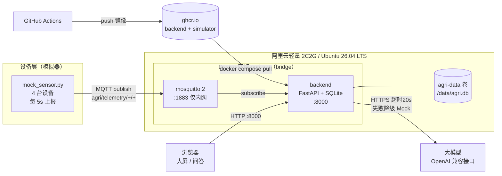
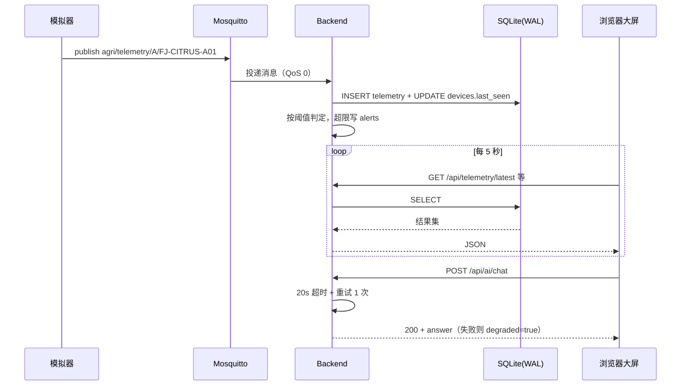

# 智慧农业 AIoT 平台

> 一个可以**一条命令跑起来**的智慧农业物联网演示系统：MQTT 采集 → 时序存储 → 实时大屏 → 大模型农技问答。

面向**阿里云轻量应用服务器 2 核 2G** 设计，Ubuntu 22.04 / 24.04 / 26.04 均可（**26.04 LTS 已在真实服务器上实测通过**）。
镜像由 GitHub Actions 构建推送到 ghcr.io，服务器**只拉不构建**，2G 内存也不会 OOM。

---

## 目录

- [1. 项目简介](#1-项目简介)
- [2. 功能清单](#2-功能清单)
- [3. 技术栈](#3-技术栈)
- [4. 系统架构](#4-系统架构)
- [5. 目录结构](#5-目录结构)
- [6. 方案 A：Docker 部署到阿里云轻量 2C2G（主线）](#6-方案-adocker-部署到阿里云轻量-2c2g主线)
- [7. 方案 B：本地裸机开发](#7-方案-b本地裸机开发)
- [8. 方案 C：自己构建镜像](#8-方案-c自己构建镜像)
- [9. 大模型配置](#9-大模型配置)
- [10. 一键演示流程](#10-一键演示流程)
- [11. 常见问题排错表](#11-常见问题排错表)
- [12. 接口速查表](#12-接口速查表)
- [13. V2.0 新增功能与操作说明](#13-v20-新增功能与操作说明)

---

## 1. 项目简介

本项目模拟一个**柑橘园智慧农业示范场景**：两个地块（A 区·柑橘示范园、B 区·柑橘试验园）
各部署一台环境站与一台墒情站，共 4 台设备。

设备通过 MQTT 上报温湿度、土壤墒情、土壤温度、电量；后端订阅入库（SQLite + WAL）；
前端大屏 5 秒轮询渲染实时曲线、设备状态、墒情仪表、告警面板与地块点位图；
并接入大模型（OpenAI 兼容接口）提供农技问答。

**核心设计取舍**：整条链路里最不可控的是大模型，所以它的每一次调用都有超时、重试与
Mock 降级兜底——**没有 API Key 也能完整演示**。

---

## 2. 功能清单

**数据链路**

- MQTT 订阅 `agri/telemetry/+/+`，QoS 0、非保留消息、JSON payload
- SQLite 存储，**开启 WAL**，读写并发不互锁
- 启动幂等建表（devices / telemetry / ai_chat / alerts）
- 设备在线判定：30 秒无上报即 `offline`
- 遥测保留策略：默认保留 7 天，自动清理

**实时大屏**

- 温湿度实时折线图（5 秒刷新）
- 设备状态卡片（绿点在线 / 红点离线）
- 土壤墒情仪表盘
- 告警面板（红色高亮 + 一键确认）
- 多地块设备点位图
- AI 对话（模型下拉 + 历史侧栏）

**告警引擎**

- temperature：正常 15~35℃，>38 或 <5 → critical，35~38 或 5~15 → warning
- humidity：正常 40~85%，<30 或 >95 → critical，>85 或 <40 → warning
- soil_moisture：正常 35~80%，<35 → warning，<25 → critical

**大模型问答**

- OpenAI 兼容接口，自动发现可用模型
- 20 秒硬超时 + 1 次重试 + Mock 降级（HTTP 始终 200）
- `latency_ms` 逐条埋点落库

**V2.0 决策中枢（新增）**

- **配置中心**：WebUI 齿轮弹窗里填 Base URL / API Key / 模型名，**保存即热生效，无需改代码、无需重启容器**；
  模型下拉来自 `GET /api/models` 自动发现。优先级 `runtime_config.json` > 环境变量 > 内置 Mock。
- **2.5D 地块视图**：两个地块按 `{col,row}` 网格坐标铺开，作物 / 面积 / 物候期来自 `GET /api/meta`。
- **因果推演树**：`POST /api/reasoning/simulate` 返回一棵「当前数据 → 风险 → 处置」三节点树，前端按树渲染。
- **白盒溯源**：推演树可展开三步时间轴（环境数据读取 / 匹配农学规则 / 大模型结论生成），
  并可通过 `GET /api/reasoning/{id}` 看到**完整 Prompt 原文与模型原始返回**。
- **指令闭环**：处置节点可直接下发指令，走 MQTT（QoS 1）→ 模拟器**真实改变后续采样** → 回执落库，
  状态机 `dispatched` / `executed` / `failed` / `timeout`。
- **农资 SKU 挂载**：推演节点带 `sku_keywords`，自动匹配 `GET /api/shop/skus`，把决策闭环延伸到采购闭环。
- **大字模式**：顶栏一键切换，放大字号与对比度，适合田间强光下使用。
- **移动端 `/mobile`**：单手可操作的移动端布局。
- **`/legacy`**：V1 大屏完整保留，老用户操作习惯不被打断。
- **气象 Mock**：模拟器按 `WEATHER_INTERVAL_SECONDS` 上报 `agri/weather/{plot_code}`，
  后端提供最新观测 + 未来 24h 确定性预报。

**部署与运维**

- Docker Compose 三服务编排，一条命令启动
- GitHub Actions 构建镜像到 ghcr.io，服务器零构建
- 健康检查 `/api/health`，容器自动重启
- 保姆级脚本 `scripts/dev_up.sh` / `scripts/dev_up.ps1`

---

## 3. 技术栈

| 层次 | 选型 | 说明 |
|---|---|---|
| 后端 | Python 3.12 + FastAPI + Uvicorn | 异步、自带 OpenAPI 文档 |
| 数据库 | SQLite（**WAL 模式**） | 单文件、零运维，2C2G 够用 |
| 消息 | Eclipse Mosquitto 2 + paho-mqtt | 轻量 MQTT broker，1883 仅内网 |
| 前端 | Vue 3 + Vite + ECharts | 深色科技感大屏 |
| 大模型 | OpenAI 兼容 HTTP 接口 | 可接通义 / DeepSeek / 任意兼容网关 |
| 容器 | Docker + Docker Compose v2 | 三服务编排 |
| CI/CD | GitHub Actions → ghcr.io | 构建与部署分离 |
| 服务器 | 阿里云轻量 2C2G / Ubuntu 22.04·24.04·26.04 | 目标运行环境（26.04 已实测） |

**依赖极简原则**：前端只用 `vue` / `echarts` / `vite` / `@vitejs/plugin-vue`，
后端只用 `fastapi` / `uvicorn` / `paho-mqtt` / `httpx`（`.env` 由 Docker Compose 的 `env_file` 注入，不依赖 `python-dotenv`）。
不引入 UI 框架、状态库、ORM。**每少一个依赖，构建峰值内存就低一截。**

**V2.0 新增能力同样不引新依赖**：路由是 30 行手写的 `frontend/src/router.js`
（`history.pushState` + `popstate`，未命中回落 `/`），弹层与 Toast 自己写，
推演与配置中心全在后端用标准库 + 已有依赖实现。

---

## 4. 系统架构

### 4.1 部署架构



### 4.2 数据流



### 4.3 端口与暴露面

| 服务 | 容器端口 | 宿主机 | 公网 |
|---|---|---|---|
| backend | 8000 | **8000** | ✅ 需安全组放行 |
| mosquitto | 1883 | 不映射 | ❌ 仅容器内网 |
| simulator | — | — | ❌ 只做出站连接 |

**对外只有一个端口 8000，一条安全组规则。** 前端由后端同源托管，无独立前端容器。

---

## 5. 目录结构

```
agri-aiot-platform/
├── .github/
│   └── workflows/
│       └── build-push.yml        # CI：构建 backend + simulator 镜像推送到 ghcr.io
├── backend/                      # 【后端】FastAPI 服务
│   ├── app/
│   │   ├── __init__.py           # 包标记（空）
│   │   ├── main.py               # 应用入口：路由注册 + StaticFiles + SPA 回退
│   │   ├── config.py             # 全部配置从环境变量读，含告警阈值常量
│   │   ├── db.py                 # SQLite 连接、WAL、幂等建表
│   │   ├── schemas.py            # Pydantic 响应模型（字段与契约第 5 节逐字段一致）
│   │   ├── timeutil.py           # 时间助手：全系统统一 ISO8601 带时区
│   │   ├── alerts.py             # 阈值规则引擎（契约第 6 节 + 告警冷却去重）
│   │   ├── mqtt_client.py        # MQTT 订阅、消息落库，并触发告警评估
│   │   ├── llm.py                # 大模型调用：超时 / 重试 / Mock 降级 / latency 埋点
│   │   ├── runtime_config.py     # 【V2】运行时配置中心：读写 runtime_config.json、Key 掩码、探活
│   │   ├── knowledge.py          # 【V2】农学先验规则引擎（不依赖大模型，纯函数）
│   │   ├── reasoning.py          # 【V2】Context Engineering 推演 + 三段式降级 + 交叉校验
│   │   ├── command.py            # 【V2】指令状态机：dispatched / executed / failed / timeout
│   │   ├── weather.py            # 【V2】气象观测读取 + 未来 24h 确定性预报
│   │   ├── routers/              # 各业务路由：__init__.py / ai.py / alerts.py
                                  # devices.py / meta.py / telemetry.py
                                  # 【V2】config.py / reasoning.py / command.py / weather.py / shop.py
│   │   └── static/               # 前端构建产物落点（gitignore，由脚本或镜像填入）
│   ├── requirements.txt          # fastapi / uvicorn / paho-mqtt / httpx / pydantic
│   └── Dockerfile                # 多阶段：node 构建前端 → python 运行
├── frontend/                     # 【前端】Vue3 + Vite
│   ├── src/
│   │   ├── main.js               # 入口：挂载 App、引入全局主题样式
│   │   ├── App.vue               # 根组件：按路由分发（/ → MainView、/legacy → LegacyView、其余 → MobileView）
│   │   ├── router.js             # 【V2】手写极简路由（3 条路由，未命中回落 /）
│   │   ├── sourceLabel.js        # 【V2】三段式降级角标：主模型生成 / 主模型生成·已校正 / 离线降级策略
│   │   ├── toast.js              # 【V2】轻量 Toast 总线
│   │   ├── api.js                # 接口封装：统一超时 + ApiError（保留状态码与 detail）
│   │   ├── config.js             # 前端可调参数（VITE_*，带安全默认值）
│   │   ├── echarts.js            # ECharts 按需引入，只注册用到的图表与组件
│   │   ├── styles/
│   │   │   └── theme.css         # 深色科技感主题：颜色/间距全部走 CSS 变量
│   │   ├── views/                # 【V2】MainView.vue（V2 主大屏）/ MobileView.vue
│   │   │                         # LegacyView.vue + V1Screen.vue（V1 大屏原样保留）
│   │   └── components/           # RealtimeChart.vue / DeviceStatusCard.vue
                                  # SoilGauge.vue / AlertPanel.vue / PlotMap.vue / AiChat.vue
                                  # 【V2】PlotGrid25D.vue / ReasoningTree.vue / ReasoningWhitebox.vue
                                  # 【V2】SettingsModal.vue / SkuCard.vue / CommandButton.vue
                                  # 【V2】ToastHost.vue / AccessiblePanel.vue / MobileShell.vue
│   ├── index.html                # Vite 入口 HTML
│   ├── vite.config.js            # build.outDir = dist；dev 代理 /api → 127.0.0.1:8000
│   ├── package.json
│   └── package-lock.json         # 锁定依赖版本，保证构建可复现
├── simulator/
│   ├── mock_sensor.py            # MQTT 模拟器：4 台设备定时上报
│   ├── requirements.txt          # 模拟器依赖（仅 paho-mqtt）
│   └── Dockerfile
├── mosquitto/
│   └── mosquitto.conf            # broker 配置（仅内网，不映射宿主机端口）
├── scripts/
│   ├── dev_up.sh                 # 裸机一键启动（Ubuntu / macOS）
│   ├── dev_up.ps1                # 裸机一键启动（Windows）
│   └── seed_history.py           # 灌历史数据，让演示现场立刻有曲线
├── docs/
│   ├── CONTRACT.md               # 接口契约（冻结版，唯一真相）
│   ├── ARCHITECTURE.md           # 目录结构 + 数据库设计（表/索引/阈值/MQTT/接口清单）
│   ├── V2_PLAN.md                # V2.0 实施方案（新增表 / 接口 / 推演树结构 / 降级口径）
│   ├── V2_PITCH.md               # V2.0 答辩防御话术（主问题 / 追问 / 演示脚本 / 风险兜底）
│   ├── PROJECT_AUDIT.md          # 生产环境实测审计报告（依赖 / 规模 / 库 / 延迟 / 资源 / 闭环证据）
│   ├── SPEECH_3MIN.md            # 3 分钟答辩逐字稿 + 数字速查卡
│   ├── CAREER_PLAN.md            # 职业规划大赛《生涯发展报告》（成长赛道）
│   └── API.md                    # 接口文档（22 条：V1 11 条 + V2 11 条，方法/参数/示例请求/示例响应）
├── docker-compose.yml            # 默认：拉 ghcr 预构建镜像
├── docker-compose.build.yml      # 可选：本地构建覆盖文件
├── .dockerignore                 # 构建上下文排除（.venv / node_modules / dist / data / .env …）
├── .env.example                  # 全部 25 个环境变量 + 中文注释（含 V2 新增 4 个）
├── .gitignore
├── README.md                     # 本文件
└── CHANGELOG.md                  # 含「技术难点与解决思路」演讲稿素材
```

> `backend/app/static/`、`data/`、`logs/`、`.env`、`*.db`、`runtime_config.json` 均已在 `.gitignore` 中，不会入库。
> （`runtime_config.json` 含用户明文 API Key，除 `data/` 通配外还额外加了一条显式规则兜底，
> 因为它的路径可由 `RUNTIME_CONFIG_PATH` 改到任意位置。）

---

## 6. 方案 A：Docker 部署到阿里云轻量 2C2G（主线）

> **这是推荐路径。** 全程约 10 分钟，服务器不构建镜像，2G 内存稳跑。

**本节命令均在真实服务器上实测过。以下是实测环境事实**（与网上教程的常见假设不同，请以本节为准）：

| 项 | 实测值 |
|---|---|
| 系统 | Ubuntu **26.04 LTS** (resolute)，x86_64，2 核（22.04 / 24.04 同样适用） |
| 内存 / 磁盘 | MemTotal **1820073984 B**（约 1735MB，可用约 998MB）；**已自带 4GB swap**（`/swapfile` 已启用）；磁盘 40G 用 21% |
| **Docker** | ✅ **已安装且已运行**：`Docker version 29.7.2, build a7dcaa6`、`Docker Compose version v5.5.0`、`systemctl is-active docker` → **active**；驱动 overlayfs、cgroup v2 |
| **daemon.json** | ✅ **已配好** registry mirror（具体地址随机器而异，用 `cat /etc/docker/daemon.json` 查看当前值） |
| ghcr 镜像代理 | 可选：若你的机器配了 ghcr 代理，`IMAGE_REGISTRY` 填 `<你的代理域名>/<owner>`（**两段**）；不填则直连 `ghcr.io`（见 [6.7](#67-拉取镜像直连-ghcrio-可用国内代理可选加速)） |
| Docker Hub 代理 | 该机 `registry-1.docker.io` 不通，靠 `daemon.json` 里的 registry mirror 绕行（具体地址随机器而异） |
| `ghcr.io` 直连 | ✅ **可用**：`/v2/` 返回 401 只是 registry 的**正常未授权响应**（此时谁都没带 token），不代表拉不到公共镜像；实测 `docker pull ghcr.io/tss-small-sunshine/agri-aiot-platform:latest` → **Downloaded newer image**（digest `sha256:1602da34…dadb2d`） |
| `registry-1.docker.io` | ❌ **不通**（靠 Docker Hub 代理绕行） |
| `github.com` | ❌ **不通** → **不能**在服务器上 `git clone`，改用 scp 传文件 |
| `download.docker.com` | ❌ **不通** → 不要用官方 `get.docker.com` 脚本（本机已装好，无需再装） |
| 备用加速器（第三方公开服务） | `https://docker.m.daocloud.io`（实测 `/v2/` 返回 401 = 可达）；**第三方公开加速器，可用性会变**，仅当自己的代理失效时试用 |
| 不可用加速器 | ❌ dockerproxy.com、mirror.ccs.tencentyun.com、hub-mirror.c.163.com、docker.1panel.live、registry.docker-cn.com（均 000） |
| 端口现状 | 仅 22 监听，**8000 空闲**；ufw inactive、iptables INPUT ACCEPT（**仍需在阿里云控制台放行 8000**） |
| `/data` | **尚不存在**——compose 用命名卷 `agri-data`，无需手工创建 |

> 一句话总结：**Docker 已装好（29.7.2 / compose v5.5.0）→ scp 传 3 个必需文件（+1 个可选）→ `docker compose pull && up -d`**（镜像直连 `ghcr.io` 即可，国内代理可选）。
> 全程不需要装 Docker、不需要配加速器、不需要 `git clone`、不需要在服务器上构建。

### 6.1 买服务器

1. 打开 [阿里云轻量应用服务器](https://www.aliyun.com/product/swas)，点「立即购买」。
2. **地域**：选离你最近的（如华东1·杭州）。
3. **镜像**：选「**系统镜像 → Ubuntu 22.04 / 24.04 / 26.04**」（26.04 LTS 已实测）。⚠️ **不要选「应用镜像」**，那些自带面板会白占内存。
4. **套餐**：2 核 2G、40G ESSD、峰值带宽 3Mbps 起步即可。
5. 设置 root 密码（记好），购买完成。
6. 在控制台记下**公网 IP**。

### 6.2 放行 8000 端口（必做，否则外网打不开）

控制台 → 你的实例 → **防火墙**（有的版本叫「安全组」）→ **添加规则**：

| 字段 | 填 |
|---|---|
| 应用类型 | 自定义 |
| 协议 | TCP |
| 端口范围 | **8000** |
| 备注 | agri-aiot-platform 大屏 |

> 1883 端口**不需要**放行——mosquitto 只在容器内网，公网无暴露面。
> 22 端口默认已放行，用于 SSH。

### 6.3 SSH 登录

在你自己电脑的终端里（Windows 用 PowerShell 或 Git Bash）：

```bash
ssh root@<你的公网IP>
```

首次连接会问 `Are you sure you want to continue connecting?`，输 `yes`，然后输密码。

### 6.4 确认 Docker 环境（本机已装好，通常无需操作）

> **这台服务器已经装好 Docker 并且正在运行**，正常情况下直接跳到
> [6.5 上传部署文件](#65-上传部署文件) 即可。
> 本节只是确认步骤，以及"万一没装"时的补救路径。

```bash
docker --version             # 期望：Docker version 29.7.2, build a7dcaa6
docker compose version       # 期望：Docker Compose version v5.5.0
systemctl is-active docker   # 期望：active
```

实测本机三项输出分别是 `Docker version 29.7.2, build a7dcaa6`、
`Docker Compose version v5.5.0`、`active`（存储驱动 overlayfs、cgroup v2）。

> 注意是 **`docker compose`（v2 子命令，中间是空格）**，不是老式的 `docker-compose`（连字符）。
> 本 README 全部使用前者。

**先看本机镜像加速的现状**——加速地址随机器而异，不要照抄别人的：

```bash
cat /etc/docker/daemon.json
```

若里面已有 `registry-mirrors`（形如下面的占位符），说明 Docker Hub 走的是该 mirror——
这就是 `eclipse-mosquitto:2` 能从 Docker Hub 拉下来的原因：

```json
{"registry-mirrors":["<你的镜像加速地址>"]}
```

ghcr 镜像**直连即可**，[6.7](#67-拉取镜像直连-ghcrio-可用国内代理可选加速) 里的代理只是可选的加速手段。

<details>
<summary>万一 `docker --version` 失败：用 apt 装（点击展开）</summary>

> ⚠️ **不要用官方脚本 `curl -fsSL https://get.docker.com | sudo sh`**。
> 实测这台服务器 **`download.docker.com` 不通（HTTP 000）**，官方脚本必然失败。
> Ubuntu 官方源自带 `docker.io` 与 `docker-compose-v2`（apt 源 `mirrors.cloud.aliyuncs.com` 可达）。

```bash
sudo apt-get update
sudo apt-get install -y docker.io docker-compose-v2
sudo systemctl enable --now docker
```

**顺便建议给容器日志限容**——2C2G 的机器磁盘小，日志不限制会把盘写满。
把 `log-driver` / `log-opts` 合并进现有的 daemon.json，再 `sudo systemctl restart docker`：

```json
{
  "registry-mirrors": ["<你的镜像加速地址>"],
  "log-driver": "json-file",
  "log-opts": { "max-size": "10m", "max-file": "3" }
}
```

> **实测不可达、不要写进 daemon.json 的地址**（写了会拖慢拉取甚至报错）：
> `dockerproxy.com`、`mirror.ccs.tencentyun.com`、`hub-mirror.c.163.com`、
> `docker.1panel.live`、`registry.docker-cn.com` —— 均返回 000。
> 备用可用地址是 `https://docker.m.daocloud.io`（第三方公开加速器，`/v2/` 返回 401 = 可达，可用性会变）。

</details>

**检查 swap（本机已自带 4GB，无需新建）**

```bash
swapon --show      # 有输出说明 swap 已启用
free -h            # 看 Swap 那一行
```

实测该机型**系统自带 4GB swap（`/swapfile` 已启用）**，MemTotal **1820073984 B**
（约 1735MB，可用约 998MB），磁盘 40G 用 21%。
若你的机器 `swapon --show` 为空，再按 [8.3 技巧 1](#83-2c2g-上构建的内存优化技巧) 扩容。

### 6.5 上传部署文件

> ⚠️ **不要在服务器上 `git clone`**。实测这台服务器 **`github.com` 不通（HTTP 000）**，
> `git clone` 会卡住或直接失败。拉镜像不受影响——实测 `ghcr.io` **直连可用**，详见 [6.7](#67-拉取镜像直连-ghcrio-可用国内代理可选加速)。

部署需要 **3 个必需文件 + 1 个可选文件**，从你本机传上去即可：

| 文件 | 作用 |
|---|---|
| `docker-compose.yml` | 三服务编排 |
| `.env.example` | 环境变量模板（上传后复制成 `.env`） |
| `mosquitto/mosquitto.conf` | broker 配置，**少了它容器起不来** |
| `scripts/seed_history.py` | 可选，只在要做[第 10 节一键演示](#10-一键演示流程)灌历史数据时需要 |

> ⚠️ 传完文件**先按 [6.6](#66-配置-env) 生成 `.env` 再执行任何 `docker compose` 命令**——
> `docker-compose.yml` 里有 `env_file: .env`，缺了这个文件 `docker compose up` 会直接报错退出。

**方式一：scp 上传（推荐）**

在你**本机**的终端里执行（注意路径按你本地实际仓库位置改）：

```bash
# 在服务器上先建目录（scripts/ 也要一起建，否则下一步传 seed_history.py 会失败）
ssh root@<你的公网IP> "mkdir -p ~/agri-aiot-platform/mosquitto ~/agri-aiot-platform/scripts"

# 3 个必需文件
scp docker-compose.yml           root@<你的公网IP>:~/agri-aiot-platform/
scp .env.example                 root@<你的公网IP>:~/agri-aiot-platform/
scp mosquitto/mosquitto.conf     root@<你的公网IP>:~/agri-aiot-platform/mosquitto/

# 可选（第 4 个文件）：演示要灌历史数据时才需要
scp scripts/seed_history.py      root@<你的公网IP>:~/agri-aiot-platform/scripts/
```

**方式二：在服务器上用 nano 粘贴**

```bash
mkdir -p ~/agri-aiot-platform/mosquitto ~/agri-aiot-platform/scripts
cd ~/agri-aiot-platform

nano docker-compose.yml
nano .env.example
nano mosquitto/mosquitto.conf
```

> 内容分别照抄本仓库同名文件即可。**`mosquitto.conf` 最容易漏**——漏了
> mosquitto 容器会以非零码退出，`docker compose ps` 里显示 `Exited`。

<details>
<summary>如果确实需要在服务器上取仓库代码（点击展开）</summary>

`github.com` 不通，但 `api.github.com` 返回 200、`codeload.github.com` 返回 301，
所以只能走 **API tarball** 这条窄路：

```bash
# 私有仓库需要带 token；公开仓库可不带
curl -fL -o repo.tar.gz \
  https://api.github.com/repos/<owner>/agri-aiot-platform/tarball/main

tar -xzf repo.tar.gz
mv <owner>-agri-aiot-platform-* agri-aiot-platform
```

**不推荐**：服务器上不构建镜像，拷一份 compose 文件就够，没必要为几个文件绕这条路。

</details>

### 6.6 配置 .env

```bash
cp .env.example .env
nano .env
```

**最小可用配置**：什么都不用改，直接保存退出（`Ctrl+O` → 回车 → `Ctrl+X`）。
默认值已经能跑：无 API Key 时 AI 走 Mock，其余功能完整。

想接大模型的话，只改这三行（详见 [第 9 节](#9-大模型配置)）：

```bash
OPENAI_BASE_URL=https://dashscope.aliyuncs.com/compatible-mode/v1
OPENAI_API_KEY=sk-你的Key
OPENAI_MODEL=qwen-plus
```

> ⚠️ `.env` 已在 `.gitignore` 中，**不会**被提交。也**不要**把 Key 贴到任何地方。

### 6.7 拉取镜像（直连 ghcr.io 可用，国内代理可选加速）

> **先说结论：直连 `ghcr.io` 就能拉。** 实测在这台服务器上
> `docker pull ghcr.io/tss-small-sunshine/agri-aiot-platform:latest` → **Downloaded newer image**，
> digest `sha256:1602da34457b4c8397687843e6286a9d2d1a9097500b0a876bea497679dadb2d`；
> 随后 `docker compose pull && docker compose up -d` 三个镜像全部拉取成功、三个容器全部 `Started`。
>
> **别被 `/v2/` 的 401 吓到**：`https://ghcr.io/v2/` 返回 401 是 registry 的**正常未授权响应**
> （此时谁都没带 token），不代表拉不到公共镜像；它的匿名 token 接口实测返回 200。
> 国内代理只是**可选的加速手段**，不是必做步骤。

`docker-compose.yml` 里的镜像名写的是
`${IMAGE_REGISTRY:-ghcr.io/tss-small-sunshine}/agri-aiot-platform...`，
默认值**已经包含 owner 那一层**，所以什么都不设就是直连：

| 走哪条路 | `IMAGE_REGISTRY` 填什么 |
|---|---|
| **直连 ghcr.io（默认，实测可用）** | 不用设（等价于 `ghcr.io/tss-small-sunshine`） |
| 国内 ghcr 代理（可选，链路在国内更快） | `<你的代理域名>/tss-small-sunshine`（**必须两段**，见下方警告） |

> ⚠️ **代理值必须写成 `<你的代理域名>/<owner>` 两段。** 只写裸代理域名
> 会变成拉 `代理域名/agri-aiot-platform`，丢掉 owner 那一段，实测直接失败：
> `Error response from daemon: no matching manifest for linux/amd64/v4 in the manifest list entries: ... not found`。

**完整可复制序列**（在服务器 `~/agri-aiot-platform` 目录下执行）：

```bash
cd ~/agri-aiot-platform

# 1) 确认 compose 解析出的镜像名（默认应看到三条 ghcr.io/tss-small-sunshine/...）
docker compose config | grep 'image:'

# 2) 拉三个镜像：后端、模拟器、mosquitto
docker compose pull

# 3) 启动
docker compose up -d
```

想改用国内代理加速时，`export` 之后再执行同样的两步：

```bash
export IMAGE_REGISTRY=<你的代理域名>/tss-small-sunshine
docker compose config | grep 'image:'    # 确认是 代理域名/tss-small-sunshine/agri-aiot-platform
docker compose pull
```

> 想让代理**永久生效**（不必每次 export），把这一行追加进 `.env` 即可
> ——注意**不要漏掉 `/tss-small-sunshine`**：
>
> ```bash
> echo 'IMAGE_REGISTRY=<你的代理域名>/tss-small-sunshine' >> .env
> ```
>
> `.env` 在 [6.6](#66-配置-env) 里由 `.env.example` 复制而来，`docker compose`
> 会自动读取同目录下的 `.env` 做变量插值。

> 注意 `IMAGE_REGISTRY` 只影响 **compose 的变量插值**（决定镜像地址），
> **不会**注入 backend / simulator 容器的进程环境——容器内的环境变量由 `env_file: .env` 提供。

**换成你自己的镜像仓库**：把 `IMAGE_REGISTRY` 整体替换成 `<registry>/<owner>` **两段**
（例如 `ghcr.io/<你的用户名或组织>`、
`<你的代理域名>/<你的用户名或组织>`）——**owner 这一段不能省**。
注意 **ghcr.io / Docker 的仓库名必须全小写**——CI 里已经用
`${GITHUB_REPOSITORY_OWNER,,}` 强制转小写，见 `.github/workflows/build-push.yml`。

> 代理地址本身也是外部服务，哪天它挂了：去掉 `export IMAGE_REGISTRY` 那行即回到**直连**（实测可用），
> 或改用备用加速器 `docker.m.daocloud.io`（第三方公开服务，只代理 Docker Hub、不代理 ghcr，可用性会变）。

### 6.8 启动

> 镜像在 [6.7](#67-拉取镜像直连-ghcrio-可用国内代理可选加速) 里已经拉过，这里只需要把容器起起来。
> 若跳过了 6.7（没设 `IMAGE_REGISTRY`），把下面两行都执行一遍即可。

```bash
docker compose pull          # 幂等；镜像已最新时秒回
docker compose up -d
```

**预期输出**（大致如下）：

```
[+] Running 4/4
 ✔ Network agri-aiot-platform_agri-net  Created
 ✔ Container agri-mosquitto              Started
 ✔ Container agri-backend                Started
 ✔ Container agri-simulator              Started
```

> 首次 `pull` 会下载**三个**镜像，视网速 1~3 分钟：
> 两个来自 ghcr.io（后端约 210MB，模拟器约 60MB），实测**直连即可拉取**；
> 一个来自 Docker Hub（`eclipse-mosquitto:2`，约 10MB）。
> **这就是 6.4 里 daemon.json 已经配好代理的原因**——本机 `registry-1.docker.io` 直连不通（`eclipse-mosquitto:2` 靠 daemon.json 里的 Docker Hub 代理绕行）。
> ghcr.io 不需要代理；链路慢时可按 [6.7](#67-拉取镜像直连-ghcrio-可用国内代理可选加速) 选国内代理加速。

### 6.9 验证

```bash
# 1) 容器都在跑（三个服务都应是 Up）
docker compose ps

# 2) 健康检查（在服务器上）
curl -s http://127.0.0.1:8000/api/health

# 3) 从你自己电脑验证公网可达
curl -s http://<你的公网IP>:8000/api/health
```

**健康检查的预期响应**：

```json
{
  "status": "ok",
  "version": "1.0.0",
  "uptime_s": 42.7,
  "db": { "ok": true, "path": "/data/agri.db" },
  "mqtt": { "connected": true, "host": "mosquitto", "port": 1883, "topic": "agri/telemetry/+/+" },
  "llm": { "configured": false, "base_url": null, "degraded": true }
}
```

| 字段 | 期望 | 不对怎么办 |
|---|---|---|
| `status` | `"ok"` | 服务没起来，看 [排错 1](#11-常见问题排错表) |
| `db.ok` | `true` | 见 [排错 6](#11-常见问题排错表) |
| `mqtt.connected` | `true` | 见 [排错 3](#11-常见问题排错表) |
| `llm.degraded` | 无 Key 时 `true` 是正常的 | 见 [排错 10](#11-常见问题排错表) |

**再验证数据在流动**：

```bash
# 等 10 秒让模拟器上报几轮，然后看设备在线状态
curl -s http://127.0.0.1:8000/api/devices
```

`online` 应为 `4`（或接近），`items[].latest` 不是 `null` 就说明链路通了。

**最后打开大屏**：浏览器访问

```
http://<你的公网IP>:8000
```

### 6.10 看日志

```bash
docker compose logs -f              # 所有服务，实时跟随
docker compose logs -f backend      # 只看后端
docker compose logs -f simulator    # 只看模拟器
docker compose logs --tail=100 backend   # 只看最后 100 行
```

按 `Ctrl+C` 退出日志跟随，**容器不会被停掉**。

### 6.11 常用运维命令

```bash
docker compose ps                   # 查看状态
docker compose restart backend      # 重启后端
docker compose stop                 # 停止（保留容器与数据）
docker compose start                # 再次启动
docker compose down                 # 停止并删除容器（数据卷保留，数据不丢）
docker compose down -v              # ⚠️ 连数据卷一起删，数据全丢

docker compose pull && docker compose up -d     # 升级到最新镜像（推荐）
```

> **数据在哪**：全部在 Docker 卷 `agri-data` 里（容器内 `/data/agri.db`）。
> `down` 不会删它，`down -v` 才会。备份一条命令：
> ```bash
> docker run --rm -v agri-aiot-platform_agri-data:/data -v $(pwd):/backup alpine \
>   tar czf /backup/agri-backup-$(date +%F).tar.gz -C /data .
> ```

### 6.12 升级流程

```bash
cd ~/agri-aiot-platform
docker compose pull                             # 拉最新镜像
docker compose up -d                            # 滚动重启（数据卷不动）
curl -s http://127.0.0.1:8000/api/health        # 验证
```

---

## 7. 方案 B：本地裸机开发

> 不用 Docker，直接在本机跑 uvicorn + 模拟器。适合改代码、调前端。
> **前提**：本机有 Python 3.10+ 与 Node.js 18+，且有一个可用的 MQTT broker
> （可本地装 mosquitto，或把 `MQTT_HOST` 指向远程 broker）。

### 7.1 Windows

```powershell
# 0) 前置：Python 3.10+、Node.js 18+（安装时勾选 Add to PATH）
python --version
node --version

# 1) 一键启动（建 venv、装依赖、构建前端、拷静态产物、起后端 + 模拟器）
powershell -ExecutionPolicy Bypass -File scripts\dev_up.ps1

# 2) 带历史数据（演示趋势曲线用）
powershell -ExecutionPolicy Bypass -File scripts\dev_up.ps1 -Seed

# 3) 只起后端，不起模拟器
powershell -ExecutionPolicy Bypass -File scripts\dev_up.ps1 -NoSim

# 4) 停止
powershell -ExecutionPolicy Bypass -File scripts\dev_up.ps1 -Stop
```

脚本会做这些事（幂等，重复执行安全）：

1. 检查 `python` / `node` / `npm`，缺失时给中文提示并退出
2. 没有 `.env` 就从 `.env.example` 复制
3. 创建 `.venv` 并安装 `backend/requirements.txt`
4. `frontend` 下 `npm install` + `npm run build`
5. 把 `frontend/dist` 拷到 `backend/app/static`
6. （`-Seed`）运行 `scripts/seed_history.py`
7. 后台启动 uvicorn 与 `mock_sensor.py`，日志写入 `logs\`

启动后打开 **http://127.0.0.1:8000**。

### 7.2 Linux / macOS

```bash
# 0) 前置
sudo apt install -y python3 python3-venv python3-pip          # Debian/Ubuntu
# Node.js 18+：推荐用 nvm
curl -o- https://raw.githubusercontent.com/nvm-sh/nvm/v0.39.7/install.sh | bash
source ~/.bashrc && nvm install 20

# 1) 一键启动
bash scripts/dev_up.sh

# 2) 带历史数据
bash scripts/dev_up.sh --seed

# 3) 只起后端
bash scripts/dev_up.sh --no-sim

# 4) 停止
bash scripts/dev_up.sh --stop
```

### 7.3 本地 MQTT broker

裸机开发需要 broker。三种选择：

```bash
# 选择 1：本地装 mosquitto（Ubuntu/Debian）
sudo apt install -y mosquitto mosquitto-clients
sudo systemctl enable --now mosquitto
# 然后 .env 里改：MQTT_HOST=127.0.0.1

# 选择 2：只跑 broker 容器（本机有 Docker 时）
docker run -d --name agri-mqtt -p 1883:1883 \
  -v "$(pwd)/mosquitto/mosquitto.conf:/mosquitto/config/mosquitto.conf:ro" \
  eclipse-mosquitto:2
# 然后 .env 里改：MQTT_HOST=127.0.0.1

# 选择 3：用 Docker Compose 只起 broker
docker compose up -d mosquitto
```

> 用 `docker compose up -d mosquitto` 时，mosquitto **没有**映射宿主机端口
> （契约要求 1883 仅内网）。要让宿主机进程连上，改用上面「选择 2」。

### 7.4 前端热更新开发

想改前端并即时看效果，用 vite devServer（已配好 `/api` 代理到 `127.0.0.1:8000`）：

```bash
# 终端 1：后端
bash scripts/dev_up.sh --no-sim        # 或先跑完整脚本，再单独起 vite

# 终端 2：前端 dev server
cd frontend
npm install
npm run dev
# 打开 http://127.0.0.1:5173
```

改完前端要**部署**时，重新 `npm run build` 并拷产物，或直接重跑一键脚本。

---

## 8. 方案 C：自己构建镜像

> 适用于想改 Dockerfile、或想构建私有镜像的场景。
> **2C2G 的服务器上不要走这条路**，会 OOM（见 [CHANGELOG 难点一](CHANGELOG.md)）。

### 8.1 本机构建并启动

```bash
# 用 build 覆盖文件，用 build: 覆盖 image:
docker compose -f docker-compose.yml -f docker-compose.build.yml up -d --build

# 只构建不启动
docker compose -f docker-compose.yml -f docker-compose.build.yml build

# 查看构建出来的镜像
docker images | grep agri-aiot-platform
```

构建上下文是**仓库根目录**（`backend/Dockerfile` 需要同时拿到 `frontend/` 做多阶段构建），
构建目标分别是 `backend/Dockerfile` 与 `simulator/Dockerfile`。

### 8.2 推到自己的仓库

镜像名里的 owner 由 `IMAGE_REGISTRY` 变量控制，默认 `ghcr.io/tss-small-sunshine`：

```bash
# 换成你自己的
export IMAGE_REGISTRY=ghcr.io/<你的GitHub用户名或组织>

# 登录 ghcr.io（需要 PAT，权限勾 write:packages）
echo $GITHUB_TOKEN | docker login ghcr.io -u <你的用户名> --password-stdin

# 构建并推送
docker compose -f docker-compose.yml -f docker-compose.build.yml build
docker compose -f docker-compose.yml -f docker-compose.build.yml push
```

### 8.3 2C2G 上构建的内存优化技巧

> 真的必须在小机器上构建时，按顺序上这四招。

**技巧 1：确认 swap 已启用（最有效，先做这个）**

实测目标机型（阿里云轻量 2C2G / Ubuntu 26.04）**系统已自带 4GB swap**，
所以先**检查**，别急着新建：

```bash
swapon --show      # 有输出 = 已启用，可以跳过下面的新建步骤
free -h            # 看 Swap 那一行
```

实测结果：总内存 1735MB、可用约 1029MB、Swap 4095MB 已启用。

**只有当 `swapon --show` 输出为空时**，才需要手动扩容：

```bash
# 新建 2G swap 文件
sudo fallocate -l 2G /swapfile
sudo chmod 600 /swapfile
sudo mkswap /swapfile
sudo swapon /swapfile

# 开机自动挂载
echo '/swapfile none swap sw 0 0' | sudo tee -a /etc/fstab

# 验证（Swap 那一行不应为 0）
free -h
```

**技巧 2：限制 BuildKit 并发与内存**

```bash
# 关掉 BuildKit 的并行，单线程构建（慢但省内存）
DOCKER_BUILDKIT=1 docker build \
  --memory=1200m \
  --memory-swap=3g \
  -f backend/Dockerfile \
  -t agri-backend .

# 或者退回旧构建器（内存占用更低，但没有缓存挂载）
DOCKER_BUILDKIT=0 docker build -f backend/Dockerfile -t agri-backend .
```

**技巧 3：给 Node 堆设上限**，让它主动 GC 而不是被内核 OOM Killer 杀掉：

```bash
docker build --build-arg NODE_OPTIONS=--max-old-space-size=768 \
  -f backend/Dockerfile -t agri-backend .
```

**技巧 4：干脆不在服务器上构建（最推荐）**

用 GitHub Actions 构建（本仓库已配好 `.github/workflows/build-push.yml`）：

1. 把代码推到 GitHub `main` 分支
2. 打开仓库 **Actions** 页，等 `build-and-push` 跑完（约 3~5 分钟）
3. 服务器上只需：
   ```bash
   docker compose pull && docker compose up -d
   ```

**CI 做了什么**：`docker/setup-buildx-action` 起 buildx → `docker/login-action` 用
`GITHUB_TOKEN` 登录 ghcr.io → `docker/metadata-action` 生成标签 →
`docker/build-push-action` 构建 `linux/amd64` 并推送，开启 `type=gha` 缓存。

**CI 是公开镜像还是私有？** ghcr 包默认继承仓库可见性。仓库公开则镜像公开，服务器可直接 `pull`；
仓库私有则服务器需先登录：

```bash
echo $GITHUB_TOKEN | docker login ghcr.io -u <你的用户名> --password-stdin
```

### 8.4 构建产物对照

| 镜像 | Dockerfile | 内容 |
|---|---|---|
| `agri-aiot-platform:latest` | `backend/Dockerfile` | FastAPI + 前端静态产物（多阶段构建） |
| `agri-aiot-platform-simulator:latest` | `simulator/Dockerfile` | MQTT 模拟器（独立入口 `mock_sensor.py`） |

---

## 9. 大模型配置

### 9.1 填哪三个变量

在 `.env` 里：

```bash
OPENAI_BASE_URL=https://dashscope.aliyuncs.com/compatible-mode/v1
OPENAI_API_KEY=sk-xxxxxxxxxxxxxxxx
OPENAI_MODEL=qwen-plus
```

**常见服务商的 `OPENAI_BASE_URL`**：

| 服务商 | OPENAI_BASE_URL | 模型名示例 |
|---|---|---|
| 阿里云百炼（通义千问） | `https://dashscope.aliyuncs.com/compatible-mode/v1` | `qwen-plus`、`qwen-turbo` |
| DeepSeek | `https://api.deepseek.com/v1` | `deepseek-chat` |
| 智谱 GLM | `https://open.bigmodel.cn/api/paas/v4` | `glm-4-flash` |
| 本地 Ollama | `http://host.docker.internal:11434/v1` | `qwen2.5:7b` |
| 自建网关 | `https://your-gateway/v1` | 看网关支持 |

> ⚠️ **末尾的 `/v1` 别漏**。后端会去 `{OPENAI_BASE_URL}/models` 发现模型，
> 少了 `/v1` 会 404，然后回落成 Mock 列表（功能不挂，但用不上真模型）。
>
> ⚠️ **Ollama 在容器里**要用 `host.docker.internal` 而不是 `localhost`——
> 容器里的 `localhost` 指的是容器自己。

### 9.2 怎么验证模型自动发现成功

```bash
curl -s http://127.0.0.1:8000/api/ai/models
```

**成功**（`configured=true`、`source=remote`、`error=null`）：

```json
{
  "configured": true,
  "degraded": false,
  "default_model": "qwen-plus",
  "error": null,
  "items": [
    { "id": "qwen-plus", "label": "qwen-plus", "source": "remote" }
  ]
}
```

**失败**（`source=mock`、`error` 写明原因）：

```json
{
  "configured": true,
  "degraded": true,
  "default_model": "mock-agronomist",
  "error": "HTTPStatusError: 401 Unauthorized",
  "items": [
    { "id": "mock-agronomist", "label": "Mock 农技专家（离线演示）", "source": "mock" }
  ]
}
```

**看 `error` 字段定位问题**：

| error 内容 | 原因 | 解决 |
|---|---|---|
| `401 Unauthorized` | Key 错 / 过期 | 换 Key |
| `404 Not Found` | `OPENAI_BASE_URL` 少 `/v1` 或路径错 | 补全路径 |
| `ConnectError` | 地址不通 / DNS 失败 | 检查地址；容器内连本机用 `host.docker.internal` |
| `ReadTimeout` | 网关慢或不通 | 调大 `OPENAI_TIMEOUT_SECONDS` |
| `429 Too Many Requests` | 限流 | 降频或换模型 |

### 9.3 无 Key 时的 Mock 行为

**这是刻意设计的，不是降级失败。** 契约硬性要求：

- `/api/ai/models` 返回 `configured=false`、`degraded=true`、`default_model="mock-agronomist"`，
  `items` 只有一条 `source="mock"`。
- `POST /api/ai/chat` **始终返回 HTTP 200**，`degraded=true`，`answer` 是内置农技知识库的答案。
- 超时、鉴权失败、限流、网络中断——**任何异常**都走同一条降级路径，`error` 写明原因。
- 前端照常渲染答案，只多一个「离线模式」角标。

**意义**：比赛现场网络抖一下、Key 过期了、服务商限流了，**演示流程都不会断档**。
没有 Key 也能完整演示全部功能——这正是 [CHANGELOG 难点三](CHANGELOG.md) 要讲的东西。

验证 Mock 可用：

```bash
curl -s -X POST http://127.0.0.1:8000/api/ai/chat \
  -H "Content-Type: application/json" \
  -d '{"question":"柑橘叶子黄了怎么办","session_id":"demo"}'
```

预期：HTTP 200，`"degraded": true`，`"model": "mock-agronomist"`。

---

## 10. 一键演示流程

> **比赛现场 3 步，全程约 1 分钟。**

### 第 1 步：起服务（约 20 秒）

```bash
cd ~/agri-aiot-platform
docker compose up -d
```

等 10 秒让模拟器上报几轮，然后确认健康：

```bash
curl -s http://127.0.0.1:8000/api/health
```

看到 `"status":"ok"` 和 `"mqtt":{"connected":true}` 就可以进入下一步。

### 第 2 步：灌历史数据（约 10 秒）

**在服务器上**执行（前提：已按 [6.5](#65-上传部署文件) 把 `scripts/seed_history.py` 一并上传）：

```bash
cd ~/agri-aiot-platform
docker compose exec -T backend python - --hours 24 --step-minutes 5 < scripts/seed_history.py
```

> 没上传脚本文件也行——**在你本机**的仓库目录里执行这条，
> 脚本内容会经 SSH 一路喂进容器（`ssh` 的 stdin → 远端命令 stdin → 容器 stdin）：
>
> ```bash
> ssh root@<你的公网IP> "cd ~/agri-aiot-platform && docker compose exec -T backend python - --hours 24 --step-minutes 5" < scripts/seed_history.py
> ```

> 这一步让大屏立刻有 24 小时的趋势曲线（4 台设备 × 288 点），而不是一条从零开始的平线。
>
> **为什么用 `python -` 而不是 `python /app/scripts/seed_history.py`**：镜像里只装了
> `backend/app`，没有 `scripts/` 目录。把脚本从**宿主机**经 stdin 送进容器的 `python -`
> 执行，解释器的 `sys.path[0]` 是 `''`（即当前工作目录 `/app`），正好能 `import app`。
> 加 `-T` 是因为 stdin 要留给脚本内容，不能给 docker 分配 TTY。
>
> 命令末尾的参数（`--hours` / `--step-minutes`）会透传给脚本，可按需调整。

看到类似下面的输出即成功（数字随设备数变化）：

```text
[seed] 已写入 1156 行遥测（4 台设备 · 约 289 点），覆盖 24.0h / 步长 5.0min
```

> 注意：seed 脚本**只灌遥测历史**，不写告警表。告警由模拟器实时上报触发，
> `docker compose up -d` 后跑一两分钟，越界点自然会在告警面板出现。

### 第 3 步：打开大屏提问

浏览器打开：

```
http://<服务器IP>:8000
```

演示动线建议：

1. **实时曲线** —— 指一下温湿度折线在动（5 秒刷新一次）
2. **设备状态** —— 4 个绿点，说明 A/B 两地块 4 台设备在线
3. **墒情仪表** —— 指一下土壤含水率是否在 35~80% 正常区间
4. **告警面板** —— 红色告警条目，点「确认」演示交互闭环
5. **地块点位图** —— 两个地块的设备分布
6. **AI 问答** —— 问「柑橘叶子黄了怎么办」，展示答案与 `latency_ms`

**如果现场网络挂了**：AI 会返回 Mock 答案并显示「离线模式」角标——
**这是特性不是故障**，可以顺势讲 [CHANGELOG 难点三](CHANGELOG.md) 的降级设计。

---

## 11. 常见问题排错表

| # | 现象 | 原因 | 命令级解决办法 |
|---|---|---|---|
| 1 | `docker compose up -d` 后 `docker compose ps` 里容器立刻 `Exited` | 启动即崩，通常是 `.env` 缺变量、端口被占或代码报错 | `docker compose logs --tail=50 backend` 看真实报错；`cp .env.example .env` 补全变量后 `docker compose up -d` |
| 2 | `Error response from daemon: Ports are not available: bind: address already in use` | 8000 端口被别的进程占了 | `sudo ss -lptn 'sport = :8000'` 找出进程；`sudo kill <PID>`，或改 `.env` 里 `APP_PORT=8001` 并把 compose 端口映射改成 `8001:8001` |
| 3 | `/api/health` 里 `mqtt.connected` 是 `false` | broker 没起 / 主机名不对 | `docker compose ps mosquitto` 确认在跑；`docker compose logs mosquitto` 看是否配置报错；`docker compose exec backend getent hosts mosquitto` 验证 DNS；`.env` 里 `MQTT_HOST` 容器内必须是 `mosquitto` |
| 4 | 大屏打开是**空白页**（白屏） | 前端产物没打进镜像 / 静态目录为空 / 控制台 JS 报错 | 先按 F12 看 Console 报错；`curl -s http://127.0.0.1:8000/ | head -c 200` 若返回一行 JSON 说明**没有前端产物**——重新 `docker compose pull && docker compose up -d`，或本地 `npm run build` 后重跑 dev_up 脚本 |
| 5 | 浏览器控制台报 `CORS policy: No 'Access-Control-Allow-Origin'` | 前端与后端不同源（用了 vite devServer 的 5173 却没走代理） | 生产环境直接用 `http://<IP>:8000`（同源，不会跨域）；开发期确认 `vite.config.js` 的 `/api` 代理生效；确实需要跨域时 `.env` 里设 `CORS_ORIGINS=http://localhost:5173` 后 `docker compose restart backend` |
| 6 | 日志报 `sqlite3.OperationalError: unable to open database file` | `/data` 不可写，或 `DB_PATH` 指向了未挂载的路径 | 确认 `docker-compose.yml` 里 `agri-data:/data` 在；`docker compose exec backend ls -ld /data` 检查权限；`.env` 里 `DB_PATH=/data/agri.db`、`DATA_DIR=/data`（容器内路径，**不要**写宿主机路径） |
| 7 | 容器被 `OOMKilled`（`docker inspect <容器> \| grep OOMKilled` 为 true） | 2G 内存不够，通常是**在服务器上构建镜像**导致的 | **别在服务器上构建**：`docker compose pull && docker compose up -d` 用预构建镜像；确认 swap 在跑 `swapon --show`（该机型自带 4GB，为空时才按 [8.3 技巧 1](#83-2c2g-上构建的内存优化技巧) 新建）；再给 compose 加 `mem_limit: 512m` 限制单容器 |
| 8 | `docker compose pull` 报 `denied` / `unauthorized` / `no such manifest` | ghcr 包是私有的，或镜像名 owner 不对 | 私有包先登录：`echo $GITHUB_TOKEN | docker login ghcr.io -u <用户名> --password-stdin`；确认 `IMAGE_REGISTRY` 与仓库 owner 一致：`IMAGE_REGISTRY=ghcr.io/<你的owner> docker compose pull` |
| 9 | 大屏时间显示差 8 小时 / 时区不对 | `python:3.12-slim` 基础镜像**不含 tzdata**，容器默认 UTC；只设 `TZ=Asia/Shanghai` 会解析失败并静默退回 UTC | 本项目 compose 已给 `backend` 与 `simulator` 挂载 `/etc/localtime:/etc/localtime:ro`，正常无需处理。若你删过这行：`docker compose exec backend date` 确认时间，把该挂载加回后 `docker compose up -d`；**不要**用 `TZ=` 环境变量（镜像里没有时区数据库，不生效） |
| 10 | 容器一直是 `health: starting` 或 `unhealthy` | 健康检查失败：应用没起、端口不对、或 `start_period` 太短 | `docker inspect --format='{{json .State.Health}}' agri-backend | python -m json.tool` 看失败原因；手动测 `docker compose exec backend python -c "import urllib.request;print(urllib.request.urlopen('http://127.0.0.1:8000/api/health').status)"`；启动慢就把 `start_period` 从 20s 调到 60s |
| 11 | 大屏一直显示「无数据」/ 曲线是平的 | 模拟器没跑，或 MQTT 主题不匹配 | `docker compose logs -f simulator` 看有没有在发布；`docker compose exec mosquitto mosquitto_sub -h 127.0.0.1 -t 'agri/telemetry/+/+' -v -C 3` 抓 3 条消息；确认 `.env` 里 `MQTT_TOPIC=agri/telemetry/+/+` 与设备码没写错 |
| 12 | 磁盘被写满 / `No space left on device` | 容器日志无上限 + 遥测数据堆积 | 给 Docker 日志限容（见 [6.4 节 daemon.json](#64-确认-docker-环境本机已装好通常无需操作)）；`docker system prune -af` 清理无用镜像层；`docker compose down && docker compose up -d` 重建容器（数据卷保留）；调小 `TELEMETRY_RETENTION_DAYS` |
| 13 | `docker compose up -d` 报 `not a directory: Are you trying to mount a directory onto a file (or vice-versa)?` | 上传文件前 `./mosquitto/` 目录不存在，Docker 会把 bind 源 `./mosquitto/mosquitto.conf` **自动创建成一个目录**；此后往这个路径传文件必然失败 | `cd ~/agri-aiot-platform && rm -rf mosquitto && mkdir -p mosquitto`，重新 `scp mosquitto/mosquitto.conf root@<你的公网IP>:~/agri-aiot-platform/mosquitto/`，再 `docker compose up -d`（[6.5](#65-上传部署文件) 的 `mkdir -p` 就是为了避开这个坑） |
| 14 | 在齿轮弹窗里填了 Key 并保存，但推演还是【离线降级策略】 | 保存的配置没生效，或 `RUNTIME_CONFIG_PATH` 指向了不可写的路径 | `curl -s http://127.0.0.1:8000/api/config` 看 `configured` 是否为 `true`、`source` 是否为 `runtime`、`path` 指向哪里；`docker compose exec backend ls -ld $(dirname <path>)` 确认可写；容器内该路径必须落在 `agri-data` 卷（默认 `/data/runtime_config.json`） |
| 15 | `POST /api/config/test` 一直 `ok=false` | 地址不对（少 `/v1`）、Key 无效、或容器出不了网 | 看返回的 `error`：`404` = Base URL 少 `/v1`；`401` = Key 错/过期；`ConnectError` = 地址不通。容器内连本机 Ollama 要用 `host.docker.internal` 而不是 `localhost` |
| 16 | 指令一直停在 `dispatched`，30 秒后变 `timeout` | 模拟器没订阅到指令（broker 不通），或指令发给了模拟器未模拟的设备 | `docker compose logs -f simulator` 看有没有『已订阅下行指令』与『收到指令』；`docker compose exec mosquitto mosquitto_sub -h 127.0.0.1 -t 'agri/command/+/+' -v -C 1` 抓一条；确认 `device_code` 在 `SIM_DEVICES` 里；必要时调大 `COMMAND_ACK_TIMEOUT_SECONDS` |
| 17 | 推演树的节点文字被画布裁切 / 深链刷新白屏 | 分别是 ECharts graph 包围盒不含 symbolSize、以及 SPA 回退把相对路径产物解析到错误层级 | 这两个问题**本项目已修**，详见 [CHANGELOG 难点四、难点五](CHANGELOG.md)。若你改过 `frontend/src/components/ReasoningTree.vue` 或 `backend/app/main.py` 的回退逻辑，请对照那两节恢复 |
| 18 | 齿轮弹窗里「测试连接」显示成功，但对话/推演仍是【离线降级策略】 | **列表通 ≠ 所选模型能调用**：中转网关会把已被上游下线的模型照样列在 `/models` 里，调用时才返回 502 `Model ... has been retired` | 看「测试连接」的结果行——若写着「接口连通，但所选模型 X 调用失败」，就**换一个模型再保存**。也可直接 `curl -s -X POST http://127.0.0.1:8000/api/config/test` 看 `model_ok`。同一个网关里可用与已退役的模型常常混在一起，逐个试是正常操作 |
| 19 | 模型下拉框里输入关键字后列表空了 / 选不中模型 | 组合框在聚焦时会**全选**已填内容（因为未选模型时会预选第一个可用模型），此时直接打字是「替换」而不是「追加」；若你手动把光标点到末尾再打字，就会拼成 `deepseek-v4.1-flashdeepseek` 这类串，自然匹配不到任何模型 | 点一下输入框（内容会被全选）后直接输入关键字；或先按 `Ctrl+A` 再输入。若列表为空，清空输入框即恢复全部模型 |

---

## 12. 接口速查表

统一前缀 `/api`，完整参数与示例响应见 **[docs/API.md](docs/API.md)**。

| 方法 | 路径 | 说明 |
|---|---|---|
| GET | `/api/health` | 健康检查（DB / MQTT / 大模型状态），**部署后先测这个** |
| GET | `/api/devices` | 设备列表 + 最新遥测 + 在线状态 |
| GET | `/api/telemetry/latest` | 全部设备最新遥测 |
| GET | `/api/telemetry/history` | 单设备历史曲线（`device_code` 必填） |
| GET | `/api/telemetry/summary` | 全局统计聚合（avg / min / max） |
| GET | `/api/alerts` | 告警列表（`limit` / `only_unacked`） |
| POST | `/api/alerts/{id}/ack` | 确认告警 |
| GET | `/api/ai/models` | 可用大模型列表（含自动发现结果） |
| POST | `/api/ai/chat` | 农技问答（超时/异常自动降级 Mock） |
| GET | `/api/ai/history` | 问答历史 |
| GET | `/api/meta` | 地块 / 告警阈值 / 模拟器配置（**V2 已扩展**为超集） |

**V2.0 新增的 11 条**（`/api/meta` 为扩展，不新增接口）：

| 方法 | 路径 | 说明 |
|---|---|---|
| GET | `/api/config` | 当前生效的大模型配置（Key **只回显掩码**） |
| PUT | `/api/config` | 写入配置并**热生效**（无需重启容器） |
| POST | `/api/config/test` | 探活并列出模型，**并实测所选模型能否调用**（`model_ok`） |
| GET | `/api/models` | 运行时模型列表（`/api/ai/models` 保留为别名） |
| POST | `/api/reasoning/simulate` | Context Engineering 推演，返回推演树 |
| GET | `/api/reasoning/history` | 推演历史摘要列表 |
| GET | `/api/reasoning/{id}` | 单次推演详情（白盒：含 Prompt 原文） |
| POST | `/api/command/execute` | 下发控制指令（MQTT + 落库） |
| GET | `/api/command/history` | 指令历史与回执状态 |
| GET | `/api/weather/latest` | 最新气象 + 未来 24h 预报 |
| GET | `/api/shop/skus` | 农资 SKU 列表 |
| GET | `/api/meta` | **扩展**：2.5D 网格坐标、作物、气象段 |

**交互式文档**：服务起来后访问 `http://<host>:8000/docs`（Swagger UI，可直接试调）。

**三条最常用的 curl**：

```bash
# 健康检查
curl -s http://127.0.0.1:8000/api/health

# 设备与在线数
curl -s http://127.0.0.1:8000/api/devices

# 问一句话
curl -s -X POST http://127.0.0.1:8000/api/ai/chat \
  -H "Content-Type: application/json" \
  -d '{"question":"柑橘叶子黄了怎么办"}'
```

---

## 13. V2.0 新增功能与操作说明

> V2.0 的核心变化是：**系统从「看数据」升级为「给决策」**——诊断、推演、白盒溯源、下发指令、挂载物资，形成一条闭环。

### 13.1 配置中心：在 WebUI 里填自己的大模型（V2 关键卖点）

**不需要改服务器代码，也不需要重启容器。**

1. 打开大屏 `http://<服务器IP>:8000`，点右上角**齿轮图标**；
2. 在弹窗里填三项：

   | 字段 | 填什么 | 示例 |
   |---|---|---|
   | Base URL | OpenAI 兼容地址，**末尾 `/v1` 别漏** | `https://dashscope.aliyuncs.com/compatible-mode/v1` |
   | API Key | 你的 Key（**表单里留空表示不改动已保存的 Key**） | `sk-xxxxxxxx` |
   | 模型 | 从下拉里选（列表来自 `GET /api/models` 自动发现） | `qwen-plus` |

3. 点保存。**立即生效**，界面上的模型名和降级角标会同步变化。

**它存在哪、为什么能热生效**

- 配置写在 `RUNTIME_CONFIG_PATH`（默认 `/data/runtime_config.json`，落在 `agri-data` 具名卷上，容器重建也不丢）；
- 优先级：**`runtime_config.json` > 环境变量（`OPENAI_BASE_URL` / `OPENAI_API_KEY` / `OPENAI_MODEL`）> 内置 Mock**；
- 后端**每次调用都重新读文件，进程内无缓存**，所以保存即生效；
- 响应里永远只回显**掩码**（形如 `sk-****abcd`），完整 Key 不出现在任何响应体里。

**命令行等价操作**

```bash
# 查看当前生效配置（Key 是掩码）
curl -s http://127.0.0.1:8000/api/config

# 写入配置（保存即热生效）
curl -s -X PUT http://127.0.0.1:8000/api/config \
  -H 'Content-Type: application/json' \
  -d '{"base_url":"https://dashscope.aliyuncs.com/compatible-mode/v1","api_key":"sk-你的Key","model":"qwen-plus"}'

# 探活：用当前配置请求 {base_url}/models
curl -s -X POST http://127.0.0.1:8000/api/config/test
```

> ⚠️ **`api_key` 的三种语义**（前端就是靠它避免误清 Key）：
> 键**缺省** = 保持不变；传 `""` 空串 = 保持不变；传 `null` = **清除**。

> ⚠️ **安全提醒**：`runtime_config.json` 含**明文 API Key**。它已在 `.gitignore` 里被显式忽略
> （除 `data/` 通配外额外加了一条 `**/runtime_config.json`，因为路径可由 `RUNTIME_CONFIG_PATH` 改到任意位置）。
> 分享截图或提交代码前请确认它没有被打包进去。

### 13.2 因果推演树与白盒溯源

**发起推演**

```bash
curl -s -X POST http://127.0.0.1:8000/api/reasoning/simulate \
  -H 'Content-Type: application/json' -d '{"plot_code":"A"}'
```

返回一棵三节点树：**根节点（当前数据）→ 风险节点（减产风险 X%）→ 处置节点（可执行动作）**。

**看白盒**：点处置节点上的「展开推演逻辑」，会展开三步时间轴：

| 步骤 | 里面有什么 |
|---|---|
| 环境数据读取 | **真实样本条数** + 设备编号 + 气温/湿度/墒情/土温/电量的实测值 + 气象 |
| 匹配农学规则 | **命中**了哪条规则、**未命中**哪些规则，逐条列出 |
| 大模型结论生成 | 产出方、与本地先验模型的偏差、是否已校正 |

**看 Prompt 原文**：`GET /api/reasoning/{id}` 比列表多两个字段——
`prompt`（实际发给大模型的完整 System + User 原文，实测约 2.2K 字符（UTF-8 约 3.0 KB，随上下文略有浮动））与 `raw_response`（模型原始返回；降级路径下为 `null`）。

**三段式降级**（这是答辩最该讲的一点）：

| 角标 | 触发条件 | `source` |
|---|---|---|
| 【主模型生成】 | 大模型返回合法 JSON 且通过 Schema 校验 | `primary` |
| 【主模型生成·已校正】 | 模型数字与先验模型偏差 > 15 个百分点，已以后端先验为准 | `primary` + `corrected=true` |
| 【离线降级策略】 | 无 Key / 超时 / 非 JSON / Schema 失败 | `fallback` |

**三条路径返回的 JSON 结构完全一致，HTTP 永远是 200，绝不冒泡成 5xx。**

### 13.3 指令闭环（真闭环，不是 Toast）

在推演树的处置节点上点「执行」，或在命令行：

```bash
curl -s -X POST http://127.0.0.1:8000/api/command/execute \
  -H 'Content-Type: application/json' \
  -d '{"plot_code":"A","device_code":"FJ-CITRUS-A02","action":"irrigation_on","params":{"duration_min":15}}'
```

**四跳链路**：

1. 后端把指令落库为 `dispatched`，返回 `command_id` / `topic` / `payload`；
2. 向 `agri/command/{plot}/{device}` 发布 MQTT 报文，**QoS 1**；
3. 模拟器订阅并调 `apply_command()`，**真实改变后续采样数值**——开滴灌会把墒情回升速率设为 0.85%/秒，
   所以**几十秒后大屏上的墒情曲线真的会回升**；
4. 模拟器向 `agri/command_ack/{plot}/{device}` 回执，后端把状态改成 `executed` 并记 `ack_at`。

**状态机**：`dispatched`（已下发，等待回执）→ `executed`（已执行并回执）/ `failed`（执行失败）/
`timeout`（超过 `COMMAND_ACK_TIMEOUT_SECONDS`（30s）未收到回执，由后台扫描任务标记）。

**动作白名单**（4 个，不在白名单内直接 422）：
`irrigation_on` / `irrigation_off` / `pesticide_dose` / `ventilation_on`。

```bash
# 查指令历史与回执状态
curl -s 'http://127.0.0.1:8000/api/command/history?limit=20'
```

### 13.4 农资 SKU 挂载

推演树的处置节点带一组 `sku_keywords`（如缺水处置带 `["滴灌带","抗旱保水剂"]`），
前端拿这组词去查 SKU 并挂在结论下面：

```bash
curl -s 'http://127.0.0.1:8000/api/shop/skus?keyword=抗旱'
```

- 启动时**幂等 seed 6 条** SKU，不覆盖用户改动；
- `keyword` 模糊匹配 `keywords` / `name` / `description` / `category`；
- `image` 字段只存一个**标识符**，前端用本地占位块渲染，**不依赖任何外网图片**。

### 13.5 大字模式与移动端

| 入口 | 地址 | 说明 |
|---|---|---|
| 大字模式 | 大屏顶栏的开关 | 放大字号与对比度，田间强光下可读。**用 `v-show` 而非 `v-if` 切换**，避免 ECharts 实例失去宿主 DOM 后不再渲染 |
| 移动端 | `http://<IP>:8000/mobile` | 单手可操作的移动端布局，适合棚里用手机看 |
| V1 大屏 | `http://<IP>:8000/legacy` | **V1 大屏完整保留**，老用户操作习惯不被打断 |
| V2 主大屏 | `http://<IP>:8000/` | 默认入口，KPI + 2.5D 地块 + 因果树 + AI 双轨对话 |

路由是**手写的 30 行极简实现**（`frontend/src/router.js`，`history.pushState` + `popstate`），
未命中的路径一律回落 `/`——为了 3 条路由引入 vue-router 会多约 20KB 和一个依赖，违背「禁止臃肿依赖」的硬约束。

### 13.6 气象 Mock 与 2.5D 地块

- 模拟器按 `WEATHER_INTERVAL_SECONDS`（默认 30s）向 `agri/weather/{plot_code}` 发布气象；
- `GET /api/weather/latest?plot_code=A` 返回最新观测 + **未来 24 小时逐时预报**；
  预报无第三方数据源，是**以最新观测为锚点的确定性日变化推演**（15 时最热、3 时最冷），离线也能画曲线；
- `GET /api/meta` 已扩展为 V1 字段的**超集**：`plots[]` 增加 `name` / `crop` / `area_mu` / `stage` / `{col,row}`，
  顶层新增 `crops[]` 与 `weather` 段。2.5D 地块视图就是按 `{col,row}` 铺开的。

### 13.7 V2.0 新增的数据表与 MQTT 主题

| 新增表 | 用途 |
|---|---|
| `reasoning` | 每次推演的结构化结论（含 `source` / `corrected` / `prompt` / `raw_response`） |
| `commands` | 指令下发与回执状态机 |
| `weather` | 气象观测（模拟器上报） |
| `skus` | 农资 SKU（幂等 seed 6 条） |

| MQTT 主题 | 方向 | QoS | 说明 |
|---|---|---|---|
| `agri/weather/{plot_code}` | 上行（新增） | 0 | 气象 Mock，每 30s 一条 |
| `agri/command/{plot_code}/{device_code}` | 下行（新增） | **1** | 后端 → 模拟器的控制指令 |
| `agri/command_ack/{plot_code}/{device_code}` | 上行（新增） | 1 | 模拟器回执，驱动指令状态 |

> 完整字段与示例响应见 **[docs/API.md](docs/API.md)**；推演树 JSON 的冻结结构见 **[docs/V2_PLAN.md](docs/V2_PLAN.md)** 第 7 节。

---

## 相关文档

- **[docs/CONTRACT.md](docs/CONTRACT.md)** —— 接口契约（冻结版，唯一真相）
- **[docs/API.md](docs/API.md)** —— 接口文档（方法 / 参数 / 示例请求 / 示例响应）
- **[docs/ARCHITECTURE.md](docs/ARCHITECTURE.md)** —— 目录结构与数据库设计（4 张表 DDL、索引、阈值规则、MQTT 约定、接口清单）
- **[docs/V2_PLAN.md](docs/V2_PLAN.md)** —— V2.0 实施方案（新增表 / 接口契约 / 推演树结构 / 降级口径）
- **[docs/V2_PITCH.md](docs/V2_PITCH.md)** —— **V2.0 答辩防御话术**（主问题四层论证 / 10 个追问应答 / 演示脚本 / 现场兜底）
- **[CHANGELOG.md](CHANGELOG.md)** —— 更新日志 + **技术难点与解决思路（演讲稿素材，V1 三个 + V2 两个）**

## 环境变量

全部 **25** 个环境变量的说明与默认值见 **[.env.example](.env.example)**（与 `docs/CONTRACT.md` 第 2 节逐字一致）。
所有可调参数一律走环境变量，代码零硬编码。

| # | 变量 | 默认值 | 说明 |
|---|---|---|---|
| 1 | `APP_PORT` | `8000` | 后端 HTTP 监听端口；compose 映射为 `8000:8000` |
| 2 | `APP_VERSION` | `1.0.0` | 版本号，出现在 `GET /api/health` 的 `version` |
| 3 | `DB_PATH` | `/data/agri.db` | SQLite 数据库文件路径（容器内必须指向挂载卷 `/data`） |
| 4 | `DATA_DIR` | `/data` | 数据目录（数据库、日志等），即 `agri-data` 卷的挂载点 |
| 5 | `MQTT_HOST` | `mosquitto` | broker 主机名；容器内用 compose 服务名 `mosquitto`，裸机改 `127.0.0.1` |
| 6 | `MQTT_PORT` | `1883` | broker 端口 |
| 7 | `MQTT_TOPIC` | `agri/telemetry/+/+` | 订阅主题通配符 |
| 8 | `DEVICE_OFFLINE_SECONDS` | `30` | `last_seen` 距今超过该值即标记 `offline` |
| 9 | `TELEMETRY_RETENTION_DAYS` | `7` | 遥测保留天数，超期自动清理 |
| 10 | `HISTORY_HOURS_MAX` | `168` | `GET /api/telemetry/history` 的 `hours` 上限（168h = 7 天） |
| 11 | `CORS_ORIGINS` | `*` | 允许的跨域来源；生产同源托管，保持 `*` 即可 |
| 12 | `OPENAI_BASE_URL` | `(空)` | OpenAI 兼容地址；留空 = 不接大模型，自动走 Mock 降级 |
| 13 | `OPENAI_API_KEY` | `(空)` | API Key；留空同样触发 Mock 降级，不报错 |
| 14 | `OPENAI_MODEL` | `(空)` | 默认模型名；留空则自动发现，无 Key 时为 `mock-agronomist` |
| 15 | `OPENAI_TIMEOUT_SECONDS` | `20` | 单次大模型调用超时秒数，超时即降级，避免大屏卡死 |
| 16 | `OPENAI_MAX_RETRIES` | `1` | 调用失败重试次数（1 = 失败后再试 1 次） |
| 17 | `AI_HISTORY_LIMIT` | `50` | `GET /api/ai/history` 返回条数上限 |
| 18 | `SIM_INTERVAL_SECONDS` | `5` | 模拟器遥测上报间隔（前端轮询同为 5s） |
| 19 | `SIM_DEVICES` | `FJ-CITRUS-A01,FJ-CITRUS-A02,FJ-CITRUS-B01,FJ-CITRUS-B02` | 模拟设备清单，逗号分隔（须与契约第 3 节一致） |
| 20 | `SIM_BAD_PROBABILITY` | `0.12` | 每次采样注入越界值的概率，用于演示告警链路；设 `0` 关闭 |
| 21 | `ALERT_COOLDOWN_SECONDS` | `300` | 同 `device_code + metric + level` 的告警冷却秒数，防刷表 |
| 22 | `RUNTIME_CONFIG_PATH` | `/data/runtime_config.json` | **V2** 配置中心落盘路径；优先级**高于环境变量**，改完即热生效 |
| 23 | `REASONING_TIMEOUT_SECONDS` | `45` | **V2** 单次推演超时秒数（推演 Prompt 更长，故比 20 宽） |
| 24 | `COMMAND_ACK_TIMEOUT_SECONDS` | `30` | **V2** 指令下发后等回执秒数，超时标记 `timeout` |
| 25 | `WEATHER_INTERVAL_SECONDS` | `30` | **V2** 模拟器气象上报间隔，与 5s 遥测解耦 |

```bash
cp .env.example .env    # 然后按需修改
```

> 另外模拟器还有一个 `SIM_WEATHER_ENABLED`（默认开启），它**不在契约第 2 节的 25 个变量里**，
> 由 `docker-compose.yml` 的 simulator 服务显式注入，用于一键关停气象上报。
