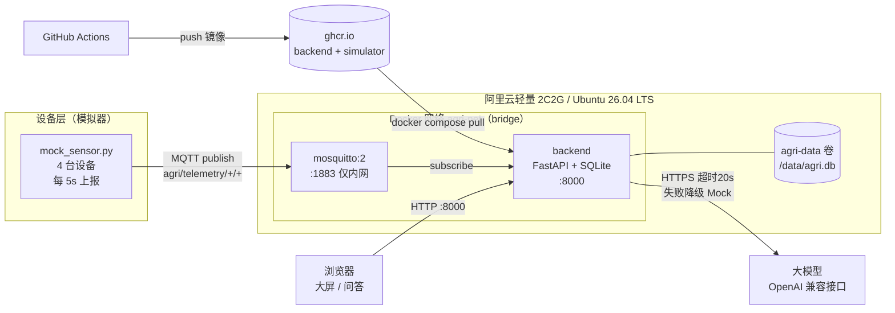
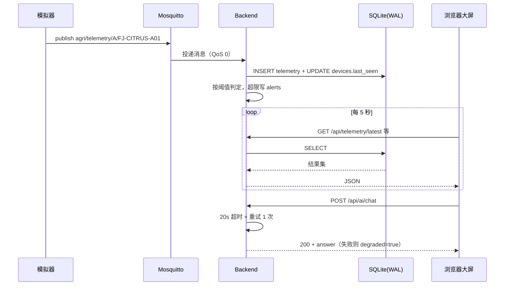

# 智慧农业 AIoT 平台

> 一个可以**一条命令跑起来**的智慧农业物联网演示系统：MQTT 采集 → 时序存储 → 实时大屏 → 大模型农技问答。

面向**阿里云轻量应用服务器 2 核 2G** 设计，Ubuntu 22.04 / 24.04 / 26.04 均可（**26.04 LTS 已在真实服务器上实测通过**）。
镜像由 GitHub Actions 构建推送到 ghcr.io，服务器**只拉不构建**，2G 内存也不会 OOM。

---

## 目录

- [1. 项目简介](#1-项目简介)
- [2. 功能清单](#2-功能清单)
- [3. 技术栈](#3-技术栈)
- [4. 系统架构](#4-系统架构)
- [5. 目录结构](#5-目录结构)
- [6. 方案 A：Docker 部署到阿里云轻量 2C2G（主线）](#6-方案-adocker-部署到阿里云轻量-2c2g主线)
- [7. 方案 B：本地裸机开发](#7-方案-b本地裸机开发)
- [8. 方案 C：自己构建镜像](#8-方案-c自己构建镜像)
- [9. 大模型配置](#9-大模型配置)
- [10. 一键演示流程](#10-一键演示流程)
- [11. 常见问题排错表](#11-常见问题排错表)
- [12. 接口速查表](#12-接口速查表)

---

## 1. 项目简介

本项目模拟一个**柑橘园智慧农业示范场景**：两个地块（A 区·柑橘示范园、B 区·柑橘试验园）
各部署一台环境站与一台墒情站，共 4 台设备。

设备通过 MQTT 上报温湿度、土壤墒情、土壤温度、电量；后端订阅入库（SQLite + WAL）；
前端大屏 5 秒轮询渲染实时曲线、设备状态、墒情仪表、告警面板与地块点位图；
并接入大模型（OpenAI 兼容接口）提供农技问答。

**核心设计取舍**：整条链路里最不可控的是大模型，所以它的每一次调用都有超时、重试与
Mock 降级兜底——**没有 API Key 也能完整演示**。

---

## 2. 功能清单

**数据链路**

- MQTT 订阅 `agri/telemetry/+/+`，QoS 0、非保留消息、JSON payload
- SQLite 存储，**开启 WAL**，读写并发不互锁
- 启动幂等建表（devices / telemetry / ai_chat / alerts）
- 设备在线判定：30 秒无上报即 `offline`
- 遥测保留策略：默认保留 7 天，自动清理

**实时大屏**

- 温湿度实时折线图（5 秒刷新）
- 设备状态卡片（绿点在线 / 红点离线）
- 土壤墒情仪表盘
- 告警面板（红色高亮 + 一键确认）
- 多地块设备点位图
- AI 对话（模型下拉 + 历史侧栏）

**告警引擎**

- temperature：正常 15~35℃，>38 或 <5 → critical，35~38 或 5~15 → warning
- humidity：正常 40~85%，<30 或 >95 → warning
- soil_moisture：正常 35~80%，<35 → warning，<25 → critical

**大模型问答**

- OpenAI 兼容接口，自动发现可用模型
- 20 秒硬超时 + 1 次重试 + Mock 降级（HTTP 始终 200）
- `latency_ms` 逐条埋点落库

**部署与运维**

- Docker Compose 三服务编排，一条命令启动
- GitHub Actions 构建镜像到 ghcr.io，服务器零构建
- 健康检查 `/api/health`，容器自动重启
- 保姆级脚本 `scripts/dev_up.sh` / `scripts/dev_up.ps1`

---

## 3. 技术栈

| 层次 | 选型 | 说明 |
|---|---|---|
| 后端 | Python 3.12 + FastAPI + Uvicorn | 异步、自带 OpenAPI 文档 |
| 数据库 | SQLite（**WAL 模式**） | 单文件、零运维，2C2G 够用 |
| 消息 | Eclipse Mosquitto 2 + paho-mqtt | 轻量 MQTT broker，1883 仅内网 |
| 前端 | Vue 3 + Vite + ECharts | 深色科技感大屏 |
| 大模型 | OpenAI 兼容 HTTP 接口 | 可接通义 / DeepSeek / 任意兼容网关 |
| 容器 | Docker + Docker Compose v2 | 三服务编排 |
| CI/CD | GitHub Actions → ghcr.io | 构建与部署分离 |
| 服务器 | 阿里云轻量 2C2G / Ubuntu 22.04·24.04·26.04 | 目标运行环境（26.04 已实测） |

**依赖极简原则**：前端只用 `vue` / `echarts` / `vite` / `@vitejs/plugin-vue`，
后端只用 `fastapi` / `uvicorn` / `paho-mqtt` / `httpx`（`.env` 由 Docker Compose 的 `env_file` 注入，不依赖 `python-dotenv`）。
不引入 UI 框架、状态库、ORM。**每少一个依赖，构建峰值内存就低一截。**

---

## 4. 系统架构

### 4.1 部署架构



### 4.2 数据流



### 4.3 端口与暴露面

| 服务 | 容器端口 | 宿主机 | 公网 |
|---|---|---|---|
| backend | 8000 | **8000** | ✅ 需安全组放行 |
| mosquitto | 1883 | 不映射 | ❌ 仅容器内网 |
| simulator | — | — | ❌ 只做出站连接 |

**对外只有一个端口 8000，一条安全组规则。** 前端由后端同源托管，无独立前端容器。

---

## 5. 目录结构

```
agri-aiot-platform/
├── .github/
│   └── workflows/
│       └── build-push.yml        # CI：构建 backend + simulator 镜像推送到 ghcr.io
├── backend/                      # 【后端】FastAPI 服务
│   ├── app/
│   │   ├── main.py               # 应用入口：路由注册 + StaticFiles + SPA 回退
│   │   ├── config.py             # 全部配置从环境变量读，含告警阈值常量
│   │   ├── db.py                 # SQLite 连接、WAL、幂等建表
│   │   ├── mqtt_client.py        # MQTT 订阅与消息落库
│   │   ├── ai.py                 # 大模型调用：超时 / 重试 / Mock 降级 / latency 埋点
│   │   ├── routers/              # 各业务路由
│   │   └── static/               # 前端构建产物落点（gitignore，由脚本或镜像填入）
│   ├── requirements.txt
│   └── Dockerfile                # 多阶段：node 构建前端 → python 运行
├── frontend/                     # 【前端】Vue3 + Vite
│   ├── src/
│   │   ├── components/           # RealtimeChart / DeviceStatusCard / SoilGauge
│   │   │                         # AlertPanel / PlotMap / AiChat
│   │   └── main.js
│   ├── vite.config.js            # build.outDir = dist；dev 代理 /api → 127.0.0.1:8000
│   └── package.json
├── simulator/
│   ├── mock_sensor.py            # MQTT 模拟器：4 台设备定时上报
│   └── Dockerfile
├── mosquitto/
│   └── mosquitto.conf            # broker 配置（仅内网，禁匿名可开）
├── scripts/
│   ├── dev_up.sh                 # 裸机一键启动（Ubuntu / macOS）
│   ├── dev_up.ps1                # 裸机一键启动（Windows）
│   └── seed_history.py           # 灌历史数据，让演示现场立刻有曲线
├── docs/
│   ├── CONTRACT.md               # 接口契约（冻结版，唯一真相）
│   ├── ARCHITECTURE.md
│   ├── PLAN.md
│   └── API.md                    # 接口文档（方法/参数/示例请求/示例响应）
├── docker-compose.yml            # 默认：拉 ghcr 预构建镜像
├── docker-compose.build.yml      # 可选：本地构建覆盖文件
├── .env.example                  # 全部 21 个环境变量 + 中文注释
├── .gitignore
├── README.md                     # 本文件
└── CHANGELOG.md                  # 含「技术难点与解决思路」演讲稿素材
```

> `backend/app/static/`、`data/`、`logs/`、`.env`、`*.db` 均已在 `.gitignore` 中，不会入库。

---

## 6. 方案 A：Docker 部署到阿里云轻量 2C2G（主线）

> **这是推荐路径。** 全程约 10 分钟，服务器不构建镜像，2G 内存稳跑。

**本节命令均在真实服务器上实测过。以下是实测环境事实**（与网上教程的常见假设不同，请以本节为准）：

| 项 | 实测值 |
|---|---|
| 系统 | Ubuntu **26.04 LTS** (resolute)，x86_64，2 核（22.04 / 24.04 同样适用） |
| 内存 / 磁盘 | MemTotal **1820073984 B**（约 1735MB，可用约 998MB）；**已自带 4GB swap**（`/swapfile` 已启用）；磁盘 40G 用 21% |
| **Docker** | ✅ **已安装且已运行**：`Docker version 29.7.2, build a7dcaa6`、`Docker Compose version v5.5.0`、`systemctl is-active docker` → **active**；驱动 overlayfs、cgroup v2 |
| **daemon.json** | ✅ **已配好**：`{"registry-mirrors":["https://<你的镜像加速地址>"]}` |
| ghcr 代理 | ✅ `https://<你的代理域名>/v2/` → **200**（**匿名可拉公共镜像**，实测 `docker pull .../linuxcontainers/alpine:latest` → Pull complete） |
| Docker Hub 代理 | ✅ `https://<你的镜像加速地址>/v2/` → **200** |
| `ghcr.io` 直连 | ⚠️ `/v2/` → 401，但其匿名 token 接口 → **403** → 直连拉取不可靠，**走上面的 ghcr 代理** |
| `registry-1.docker.io` | ❌ **不通**（靠 Docker Hub 代理绕行） |
| `github.com` | ❌ **不通** → **不能**在服务器上 `git clone`，改用 scp 传文件 |
| `download.docker.com` | ❌ **不通** → 不要用官方 `get.docker.com` 脚本（本机已装好，无需再装） |
| 备用加速器 | ✅ `https://docker.m.daocloud.io`（`/v2/` 返回 401 = 可达），仅当上面的代理失效时改用 |
| 不可用加速器 | ❌ dockerproxy.com、mirror.ccs.tencentyun.com、hub-mirror.c.163.com、docker.1panel.live、registry.docker-cn.com（均 000） |
| 端口现状 | 仅 22 监听，**8000 空闲**；ufw inactive、iptables INPUT ACCEPT（**仍需在阿里云控制台放行 8000**） |
| `/data` | **尚不存在**——compose 用命名卷 `agri-data`，无需手工创建 |

> 一句话总结：**Docker 已装好（29.7.2 / compose v5.5.0 / 代理已配）→ scp 传 3 个文件 → `docker compose pull && up -d`**。
> 全程不需要装 Docker、不需要配加速器、不需要 `git clone`、不需要在服务器上构建。

### 6.1 买服务器

1. 打开 [阿里云轻量应用服务器](https://www.aliyun.com/product/swas)，点「立即购买」。
2. **地域**：选离你最近的（如华东1·杭州）。
3. **镜像**：选「**系统镜像 → Ubuntu 22.04 / 24.04 / 26.04**」（26.04 LTS 已实测）。⚠️ **不要选「应用镜像」**，那些自带面板会白占内存。
4. **套餐**：2 核 2G、40G ESSD、峰值带宽 3Mbps 起步即可。
5. 设置 root 密码（记好），购买完成。
6. 在控制台记下**公网 IP**。

### 6.2 放行 8000 端口（必做，否则外网打不开）

控制台 → 你的实例 → **防火墙**（有的版本叫「安全组」）→ **添加规则**：

| 字段 | 填 |
|---|---|
| 应用类型 | 自定义 |
| 协议 | TCP |
| 端口范围 | **8000** |
| 备注 | agri-aiot-platform 大屏 |

> 1883 端口**不需要**放行——mosquitto 只在容器内网，公网无暴露面。
> 22 端口默认已放行，用于 SSH。

### 6.3 SSH 登录

在你自己电脑的终端里（Windows 用 PowerShell 或 Git Bash）：

```bash
ssh root@<你的公网IP>
```

首次连接会问 `Are you sure you want to continue connecting?`，输 `yes`，然后输密码。

### 6.4 确认 Docker 环境（本机已装好，通常无需操作）

> **这台服务器已经装好 Docker 并且正在运行**，正常情况下直接跳到
> [6.7 用国内 ghcr 代理加速拉取镜像](#67-用国内-ghcr-代理加速拉取镜像) 即可。
> 本节只是确认步骤，以及"万一没装"时的补救路径。

```bash
docker --version             # 期望：Docker version 29.7.2, build a7dcaa6
docker compose version       # 期望：Docker Compose version v5.5.0
systemctl is-active docker   # 期望：active
```

实测本机三项输出分别是 `Docker version 29.7.2, build a7dcaa6`、
`Docker Compose version v5.5.0`、`active`（存储驱动 overlayfs、cgroup v2）。

> 注意是 **`docker compose`（v2 子命令，中间是空格）**，不是老式的 `docker-compose`（连字符）。
> 本 README 全部使用前者。

**镜像加速已经配好了**——当前 `/etc/docker/daemon.json` 的内容就是：

```json
{"registry-mirrors":["https://<你的镜像加速地址>"]}
```

实测 `https://<你的镜像加速地址>/v2/` 返回 **200**（Docker Hub 代理）、
`https://<你的代理域名>/v2/` 也返回 **200**（ghcr 代理）——
这就是 `eclipse-mosquitto:2` 能从 Docker Hub 拉下来、以及 [6.7](#67-用国内-ghcr-代理加速拉取镜像)
能用代理拉 ghcr 镜像的原因。

<details>
<summary>万一 `docker --version` 失败：用 apt 装（点击展开）</summary>

> ⚠️ **不要用官方脚本 `curl -fsSL https://get.docker.com | sudo sh`**。
> 实测这台服务器 **`download.docker.com` 不通（HTTP 000）**，官方脚本必然失败。
> Ubuntu 官方源自带 `docker.io` 与 `docker-compose-v2`（apt 源 `mirrors.cloud.aliyuncs.com` 可达）。

```bash
sudo apt-get update
sudo apt-get install -y docker.io docker-compose-v2
sudo systemctl enable --now docker
```

**顺便建议给容器日志限容**——2C2G 的机器磁盘小，日志不限制会把盘写满。
把 `log-driver` / `log-opts` 合并进现有的 daemon.json，再 `sudo systemctl restart docker`：

```json
{
  "registry-mirrors": ["https://<你的镜像加速地址>"],
  "log-driver": "json-file",
  "log-opts": { "max-size": "10m", "max-file": "3" }
}
```

> **实测不可达、不要写进 daemon.json 的地址**（写了会拖慢拉取甚至报错）：
> `dockerproxy.com`、`mirror.ccs.tencentyun.com`、`hub-mirror.c.163.com`、
> `docker.1panel.live`、`registry.docker-cn.com` —— 均返回 000。
> 备用可用地址是 `https://docker.m.daocloud.io`（`/v2/` 返回 401 = 可达）。

</details>

**检查 swap（本机已自带 4GB，无需新建）**

```bash
swapon --show      # 有输出说明 swap 已启用
free -h            # 看 Swap 那一行
```

实测该机型**系统自带 4GB swap（`/swapfile` 已启用）**，MemTotal **1820073984 B**
（约 1735MB，可用约 998MB），磁盘 40G 用 21%。
若你的机器 `swapon --show` 为空，再按 [8.3 技巧 1](#83-2c2g-上构建的内存优化技巧) 扩容。

### 6.5 上传部署文件

> ⚠️ **不要在服务器上 `git clone`**。实测这台服务器 **`github.com` 不通（HTTP 000）**，
> `git clone` 会卡住或直接失败。（`ghcr.io` 直连也不可靠，所以 [6.7](#67-用国内-ghcr-代理加速拉取镜像) 用国内代理拉镜像。）

部署只需要 **3 个文件**，从你本机传上去即可：

| 文件 | 作用 |
|---|---|
| `docker-compose.yml` | 三服务编排 |
| `.env.example` | 环境变量模板（上传后复制成 `.env`） |
| `mosquitto/mosquitto.conf` | broker 配置，**少了它容器起不来** |
| `scripts/seed_history.py` | 可选，只在要做[第 10 节一键演示](#10-一键演示流程)灌历史数据时需要 |

> ⚠️ 传完文件**先按 [6.6](#66-配置-env) 生成 `.env` 再执行任何 `docker compose` 命令**——
> `docker-compose.yml` 里有 `env_file: .env`，缺了这个文件 `docker compose up` 会直接报错退出。

**方式一：scp 上传（推荐）**

在你**本机**的终端里执行（注意路径按你本地实际仓库位置改）：

```bash
# 在服务器上先建目录
ssh root@<你的公网IP> "mkdir -p ~/agri-aiot-platform/mosquitto"

# 从本机把三个文件传上去
scp docker-compose.yml           root@<你的公网IP>:~/agri-aiot-platform/
scp .env.example                 root@<你的公网IP>:~/agri-aiot-platform/
scp mosquitto/mosquitto.conf     root@<你的公网IP>:~/agri-aiot-platform/mosquitto/

# 可选：演示要灌历史数据时才需要
scp scripts/seed_history.py      root@<你的公网IP>:~/agri-aiot-platform/scripts/
```

**方式二：在服务器上用 nano 粘贴**

```bash
mkdir -p ~/agri-aiot-platform/mosquitto
cd ~/agri-aiot-platform

nano docker-compose.yml
nano .env.example
nano mosquitto/mosquitto.conf
```

> 内容分别照抄本仓库同名文件即可。**`mosquitto.conf` 最容易漏**——漏了
> mosquitto 容器会以非零码退出，`docker compose ps` 里显示 `Exited`。

<details>
<summary>如果确实需要在服务器上取仓库代码（点击展开）</summary>

`github.com` 不通，但 `api.github.com` 返回 200、`codeload.github.com` 返回 301，
所以只能走 **API tarball** 这条窄路：

```bash
# 私有仓库需要带 token；公开仓库可不带
curl -fL -o repo.tar.gz \
  https://api.github.com/repos/<owner>/agri-aiot-platform/tarball/main

tar -xzf repo.tar.gz
mv <owner>-agri-aiot-platform-* agri-aiot-platform
```

**不推荐**：服务器上不构建镜像，拷一份 compose 文件就够，没必要为几个文件绕这条路。

</details>

### 6.6 配置 .env

```bash
cp .env.example .env
nano .env
```

**最小可用配置**：什么都不用改，直接保存退出（`Ctrl+O` → 回车 → `Ctrl+X`）。
默认值已经能跑：无 API Key 时 AI 走 Mock，其余功能完整。

想接大模型的话，只改这三行（详见 [第 9 节](#9-大模型配置)）：

```bash
OPENAI_BASE_URL=https://dashscope.aliyuncs.com/compatible-mode/v1
OPENAI_API_KEY=sk-你的Key
OPENAI_MODEL=qwen-plus
```

> ⚠️ `.env` 已在 `.gitignore` 中，**不会**被提交。也**不要**把 Key 贴到任何地方。

### 6.7 用国内 ghcr 代理加速拉取镜像

> **为什么要这一步**：本仓库的镜像托管在 `ghcr.io`（GitHub 容器仓库）。
> 实测这台服务器 `https://ghcr.io/v2/` 返回 401，而它的**匿名 token 接口返回 403**，
> 直连拉取不可靠；即便能拉，链路在海外也很慢。
> 用国内代理可以**匿名（无需 docker login）**拉公共镜像——实测
> `docker pull <你的代理域名>/linuxcontainers/alpine:latest` → **Pull complete**。

`docker-compose.yml` 里的镜像名写的是
`${IMAGE_REGISTRY:-ghcr.io/tss-small-sunshine}/agri-aiot-platform...`，
所以**只需要把 `IMAGE_REGISTRY` 指向代理地址**，compose 文件一个字都不用改：

| 走哪条路 | `IMAGE_REGISTRY` 填什么 |
|---|---|
| **推荐：国内 ghcr 代理**（匿名、快） | `<你的代理域名>` |
| 直连 ghcr.io（可能超时 / 403） | `ghcr.io/tss-small-sunshine` |

**完整可复制序列**（在服务器 `~/agri-aiot-platform` 目录下执行）：

```bash
cd ~/agri-aiot-platform

# 1) 指向国内 ghcr 代理（只对本会话有效；写进 .env 则永久生效）
export IMAGE_REGISTRY=<你的代理域名>

# 2) 确认 compose 解析出的镜像名（应看到代理地址 + 后端 + 模拟器 + eclipse-mosquitto）
docker compose config | grep 'image:'

# 3) 拉三个镜像：后端、模拟器、mosquitto
docker compose pull

# 4) 启动
docker compose up -d
```

> 想让代理**永久生效**（不必每次 export），把这一行追加进 `.env` 即可：
>
> ```bash
> echo 'IMAGE_REGISTRY=<你的代理域名>' >> .env
> ```
>
> `.env` 在 [6.6](#66-配置-env) 里由 `.env.example` 复制而来，`docker compose`
> 会自动读取同目录下的 `.env` 做变量插值。

**如果镜像在你自己名下**，`IMAGE_REGISTRY` 写
`<你的代理域名>/<你的用户名或组织>`。
注意 **ghcr.io / Docker 的仓库名必须全小写**——CI 里已经用
`${GITHUB_REPOSITORY_OWNER,,}` 强制转小写，见 `.github/workflows/build-push.yml`。

> 代理地址本身也是外部服务，哪天它挂了：去掉 `export IMAGE_REGISTRY` 那行换回直连，
> 或改用备用加速器 `docker.m.daocloud.io`（它只代理 Docker Hub，不代理 ghcr）。

### 6.8 启动

> 镜像在 [6.7](#67-用国内-ghcr-代理加速拉取镜像) 里已经拉过，这里只需要把容器起起来。
> 若跳过了 6.7（没设 `IMAGE_REGISTRY`），把下面两行都执行一遍即可。

```bash
docker compose pull          # 幂等；镜像已最新时秒回
docker compose up -d
```

**预期输出**（大致如下）：

```
[+] Running 4/4
 ✔ Network agri-aiot-platform_agri-net  Created
 ✔ Container agri-mosquitto              Started
 ✔ Container agri-backend                Started
 ✔ Container agri-simulator              Started
```

> 首次 `pull` 会下载**三个**镜像，视网速 1~3 分钟：
> 两个来自 ghcr.io（后端约 210MB，模拟器约 60MB），
> 一个来自 Docker Hub（`eclipse-mosquitto:2`，约 10MB）。
> **这就是 6.4 里 daemon.json 已经配好代理的原因**——本机 `registry-1.docker.io` 直连不通（`eclipse-mosquitto:2` 靠 daemon.json 里的 Docker Hub 代理绕行），
> `ghcr.io` 直连也不可靠（靠 [6.7](#67-用国内-ghcr-代理加速拉取镜像) 的 ghcr 代理）。

### 6.9 验证

```bash
# 1) 容器都在跑（三个服务都应是 Up）
docker compose ps

# 2) 健康检查（在服务器上）
curl -s http://127.0.0.1:8000/api/health

# 3) 从你自己电脑验证公网可达
curl -s http://<你的公网IP>:8000/api/health
```

**健康检查的预期响应**：

```json
{
  "status": "ok",
  "version": "1.0.0",
  "uptime_s": 42.7,
  "db": { "ok": true, "path": "/data/agri.db" },
  "mqtt": { "connected": true, "host": "mosquitto", "port": 1883, "topic": "agri/telemetry/+/+" },
  "llm": { "configured": false, "base_url": null, "degraded": true }
}
```

| 字段 | 期望 | 不对怎么办 |
|---|---|---|
| `status` | `"ok"` | 服务没起来，看 [排错 1](#11-常见问题排错表) |
| `db.ok` | `true` | 见 [排错 6](#11-常见问题排错表) |
| `mqtt.connected` | `true` | 见 [排错 3](#11-常见问题排错表) |
| `llm.degraded` | 无 Key 时 `true` 是正常的 | 见 [排错 10](#11-常见问题排错表) |

**再验证数据在流动**：

```bash
# 等 10 秒让模拟器上报几轮，然后看设备在线状态
curl -s http://127.0.0.1:8000/api/devices
```

`online` 应为 `4`（或接近），`items[].latest` 不是 `null` 就说明链路通了。

**最后打开大屏**：浏览器访问

```
http://<你的公网IP>:8000
```

### 6.10 看日志

```bash
docker compose logs -f              # 所有服务，实时跟随
docker compose logs -f backend      # 只看后端
docker compose logs -f simulator    # 只看模拟器
docker compose logs --tail=100 backend   # 只看最后 100 行
```

按 `Ctrl+C` 退出日志跟随，**容器不会被停掉**。

### 6.11 常用运维命令

```bash
docker compose ps                   # 查看状态
docker compose restart backend      # 重启后端
docker compose stop                 # 停止（保留容器与数据）
docker compose start                # 再次启动
docker compose down                 # 停止并删除容器（数据卷保留，数据不丢）
docker compose down -v              # ⚠️ 连数据卷一起删，数据全丢

docker compose pull && docker compose up -d     # 升级到最新镜像（推荐）
```

> **数据在哪**：全部在 Docker 卷 `agri-data` 里（容器内 `/data/agri.db`）。
> `down` 不会删它，`down -v` 才会。备份一条命令：
> ```bash
> docker run --rm -v agri-aiot-platform_agri-data:/data -v $(pwd):/backup alpine \
>   tar czf /backup/agri-backup-$(date +%F).tar.gz -C /data .
> ```

### 6.12 升级流程

```bash
cd ~/agri-aiot-platform
docker compose pull                             # 拉最新镜像
docker compose up -d                            # 滚动重启（数据卷不动）
curl -s http://127.0.0.1:8000/api/health        # 验证
```

---

## 7. 方案 B：本地裸机开发

> 不用 Docker，直接在本机跑 uvicorn + 模拟器。适合改代码、调前端。
> **前提**：本机有 Python 3.10+ 与 Node.js 18+，且有一个可用的 MQTT broker
> （可本地装 mosquitto，或把 `MQTT_HOST` 指向远程 broker）。

### 7.1 Windows

```powershell
# 0) 前置：Python 3.10+、Node.js 18+（安装时勾选 Add to PATH）
python --version
node --version

# 1) 一键启动（建 venv、装依赖、构建前端、拷静态产物、起后端 + 模拟器）
powershell -ExecutionPolicy Bypass -File scripts\dev_up.ps1

# 2) 带历史数据（演示趋势曲线用）
powershell -ExecutionPolicy Bypass -File scripts\dev_up.ps1 -Seed

# 3) 只起后端，不起模拟器
powershell -ExecutionPolicy Bypass -File scripts\dev_up.ps1 -NoSim

# 4) 停止
powershell -ExecutionPolicy Bypass -File scripts\dev_up.ps1 -Stop
```

脚本会做这些事（幂等，重复执行安全）：

1. 检查 `python` / `node` / `npm`，缺失时给中文提示并退出
2. 没有 `.env` 就从 `.env.example` 复制
3. 创建 `.venv` 并安装 `backend/requirements.txt`
4. `frontend` 下 `npm install` + `npm run build`
5. 把 `frontend/dist` 拷到 `backend/app/static`
6. （`-Seed`）运行 `scripts/seed_history.py`
7. 后台启动 uvicorn 与 `mock_sensor.py`，日志写入 `logs\`

启动后打开 **http://127.0.0.1:8000**。

### 7.2 Linux / macOS

```bash
# 0) 前置
sudo apt install -y python3 python3-venv python3-pip          # Debian/Ubuntu
# Node.js 18+：推荐用 nvm
curl -o- https://raw.githubusercontent.com/nvm-sh/nvm/v0.39.7/install.sh | bash
source ~/.bashrc && nvm install 20

# 1) 一键启动
bash scripts/dev_up.sh

# 2) 带历史数据
bash scripts/dev_up.sh --seed

# 3) 只起后端
bash scripts/dev_up.sh --no-sim

# 4) 停止
bash scripts/dev_up.sh --stop
```

### 7.3 本地 MQTT broker

裸机开发需要 broker。三种选择：

```bash
# 选择 1：本地装 mosquitto（Ubuntu/Debian）
sudo apt install -y mosquitto mosquitto-clients
sudo systemctl enable --now mosquitto
# 然后 .env 里改：MQTT_HOST=127.0.0.1

# 选择 2：只跑 broker 容器（本机有 Docker 时）
docker run -d --name agri-mqtt -p 1883:1883 \
  -v "$(pwd)/mosquitto/mosquitto.conf:/mosquitto/config/mosquitto.conf:ro" \
  eclipse-mosquitto:2
# 然后 .env 里改：MQTT_HOST=127.0.0.1

# 选择 3：用 Docker Compose 只起 broker
docker compose up -d mosquitto
```

> 用 `docker compose up -d mosquitto` 时，mosquitto **没有**映射宿主机端口
> （契约要求 1883 仅内网）。要让宿主机进程连上，改用上面「选择 2」。

### 7.4 前端热更新开发

想改前端并即时看效果，用 vite devServer（已配好 `/api` 代理到 `127.0.0.1:8000`）：

```bash
# 终端 1：后端
bash scripts/dev_up.sh --no-sim        # 或先跑完整脚本，再单独起 vite

# 终端 2：前端 dev server
cd frontend
npm install
npm run dev
# 打开 http://127.0.0.1:5173
```

改完前端要**部署**时，重新 `npm run build` 并拷产物，或直接重跑一键脚本。

---

## 8. 方案 C：自己构建镜像

> 适用于想改 Dockerfile、或想构建私有镜像的场景。
> **2C2G 的服务器上不要走这条路**，会 OOM（见 [CHANGELOG 难点一](CHANGELOG.md)）。

### 8.1 本机构建并启动

```bash
# 用 build 覆盖文件，用 build: 覆盖 image:
docker compose -f docker-compose.yml -f docker-compose.build.yml up -d --build

# 只构建不启动
docker compose -f docker-compose.yml -f docker-compose.build.yml build

# 查看构建出来的镜像
docker images | grep agri-aiot-platform
```

构建上下文是**仓库根目录**（`backend/Dockerfile` 需要同时拿到 `frontend/` 做多阶段构建），
构建目标分别是 `backend/Dockerfile` 与 `simulator/Dockerfile`。

### 8.2 推到自己的仓库

镜像名里的 owner 由 `IMAGE_REGISTRY` 变量控制，默认 `ghcr.io/tss-small-sunshine`：

```bash
# 换成你自己的
export IMAGE_REGISTRY=ghcr.io/<你的GitHub用户名或组织>

# 登录 ghcr.io（需要 PAT，权限勾 write:packages）
echo $GITHUB_TOKEN | docker login ghcr.io -u <你的用户名> --password-stdin

# 构建并推送
docker compose -f docker-compose.yml -f docker-compose.build.yml build
docker compose -f docker-compose.yml -f docker-compose.build.yml push
```

### 8.3 2C2G 上构建的内存优化技巧

> 真的必须在小机器上构建时，按顺序上这四招。

**技巧 1：确认 swap 已启用（最有效，先做这个）**

实测目标机型（阿里云轻量 2C2G / Ubuntu 26.04）**系统已自带 4GB swap**，
所以先**检查**，别急着新建：

```bash
swapon --show      # 有输出 = 已启用，可以跳过下面的新建步骤
free -h            # 看 Swap 那一行
```

实测结果：总内存 1735MB、可用约 1029MB、Swap 4095MB 已启用。

**只有当 `swapon --show` 输出为空时**，才需要手动扩容：

```bash
# 新建 2G swap 文件
sudo fallocate -l 2G /swapfile
sudo chmod 600 /swapfile
sudo mkswap /swapfile
sudo swapon /swapfile

# 开机自动挂载
echo '/swapfile none swap sw 0 0' | sudo tee -a /etc/fstab

# 验证（Swap 那一行不应为 0）
free -h
```

**技巧 2：限制 BuildKit 并发与内存**

```bash
# 关掉 BuildKit 的并行，单线程构建（慢但省内存）
DOCKER_BUILDKIT=1 docker build \
  --memory=1200m \
  --memory-swap=3g \
  -f backend/Dockerfile \
  -t agri-backend .

# 或者退回旧构建器（内存占用更低，但没有缓存挂载）
DOCKER_BUILDKIT=0 docker build -f backend/Dockerfile -t agri-backend .
```

**技巧 3：给 Node 堆设上限**，让它主动 GC 而不是被内核 OOM Killer 杀掉：

```bash
docker build --build-arg NODE_OPTIONS=--max-old-space-size=768 \
  -f backend/Dockerfile -t agri-backend .
```

**技巧 4：干脆不在服务器上构建（最推荐）**

用 GitHub Actions 构建（本仓库已配好 `.github/workflows/build-push.yml`）：

1. 把代码推到 GitHub `main` 分支
2. 打开仓库 **Actions** 页，等 `build-and-push` 跑完（约 3~5 分钟）
3. 服务器上只需：
   ```bash
   docker compose pull && docker compose up -d
   ```

**CI 做了什么**：`docker/setup-buildx-action` 起 buildx → `docker/login-action` 用
`GITHUB_TOKEN` 登录 ghcr.io → `docker/metadata-action` 生成标签 →
`docker/build-push-action` 构建 `linux/amd64` 并推送，开启 `type=gha` 缓存。

**CI 是公开镜像还是私有？** ghcr 包默认继承仓库可见性。仓库公开则镜像公开，服务器可直接 `pull`；
仓库私有则服务器需先登录：

```bash
echo $GITHUB_TOKEN | docker login ghcr.io -u <你的用户名> --password-stdin
```

### 8.4 构建产物对照

| 镜像 | Dockerfile | 内容 |
|---|---|---|
| `agri-aiot-platform:latest` | `backend/Dockerfile` | FastAPI + 前端静态产物（多阶段构建） |
| `agri-aiot-platform-simulator:latest` | `simulator/Dockerfile` | MQTT 模拟器（独立入口 `mock_sensor.py`） |

---

## 9. 大模型配置

### 9.1 填哪三个变量

在 `.env` 里：

```bash
OPENAI_BASE_URL=https://dashscope.aliyuncs.com/compatible-mode/v1
OPENAI_API_KEY=sk-xxxxxxxxxxxxxxxx
OPENAI_MODEL=qwen-plus
```

**常见服务商的 `OPENAI_BASE_URL`**：

| 服务商 | OPENAI_BASE_URL | 模型名示例 |
|---|---|---|
| 阿里云百炼（通义千问） | `https://dashscope.aliyuncs.com/compatible-mode/v1` | `qwen-plus`、`qwen-turbo` |
| DeepSeek | `https://api.deepseek.com/v1` | `deepseek-chat` |
| 智谱 GLM | `https://open.bigmodel.cn/api/paas/v4` | `glm-4-flash` |
| 本地 Ollama | `http://host.docker.internal:11434/v1` | `qwen2.5:7b` |
| 自建网关 | `https://your-gateway/v1` | 看网关支持 |

> ⚠️ **末尾的 `/v1` 别漏**。后端会去 `{OPENAI_BASE_URL}/models` 发现模型，
> 少了 `/v1` 会 404，然后回落成 Mock 列表（功能不挂，但用不上真模型）。
>
> ⚠️ **Ollama 在容器里**要用 `host.docker.internal` 而不是 `localhost`——
> 容器里的 `localhost` 指的是容器自己。

### 9.2 怎么验证模型自动发现成功

```bash
curl -s http://127.0.0.1:8000/api/ai/models
```

**成功**（`configured=true`、`source=remote`、`error=null`）：

```json
{
  "configured": true,
  "degraded": false,
  "default_model": "qwen-plus",
  "error": null,
  "items": [
    { "id": "qwen-plus", "label": "qwen-plus", "source": "remote" }
  ]
}
```

**失败**（`source=mock`、`error` 写明原因）：

```json
{
  "configured": true,
  "degraded": true,
  "default_model": "mock-agronomist",
  "error": "HTTPStatusError: 401 Unauthorized",
  "items": [
    { "id": "mock-agronomist", "label": "Mock 农技专家（离线演示）", "source": "mock" }
  ]
}
```

**看 `error` 字段定位问题**：

| error 内容 | 原因 | 解决 |
|---|---|---|
| `401 Unauthorized` | Key 错 / 过期 | 换 Key |
| `404 Not Found` | `OPENAI_BASE_URL` 少 `/v1` 或路径错 | 补全路径 |
| `ConnectError` | 地址不通 / DNS 失败 | 检查地址；容器内连本机用 `host.docker.internal` |
| `ReadTimeout` | 网关慢或不通 | 调大 `OPENAI_TIMEOUT_SECONDS` |
| `429 Too Many Requests` | 限流 | 降频或换模型 |

### 9.3 无 Key 时的 Mock 行为

**这是刻意设计的，不是降级失败。** 契约硬性要求：

- `/api/ai/models` 返回 `configured=false`、`degraded=true`、`default_model="mock-agronomist"`，
  `items` 只有一条 `source="mock"`。
- `POST /api/ai/chat` **始终返回 HTTP 200**，`degraded=true`，`answer` 是内置农技知识库的答案。
- 超时、鉴权失败、限流、网络中断——**任何异常**都走同一条降级路径，`error` 写明原因。
- 前端照常渲染答案，只多一个「离线模式」角标。

**意义**：比赛现场网络抖一下、Key 过期了、服务商限流了，**演示流程都不会断档**。
没有 Key 也能完整演示全部功能——这正是 [CHANGELOG 难点三](CHANGELOG.md) 要讲的东西。

验证 Mock 可用：

```bash
curl -s -X POST http://127.0.0.1:8000/api/ai/chat \
  -H "Content-Type: application/json" \
  -d '{"question":"柑橘叶子黄了怎么办","session_id":"demo"}'
```

预期：HTTP 200，`"degraded": true`，`"model": "mock-agronomist"`。

---

## 10. 一键演示流程

> **比赛现场 3 步，全程约 1 分钟。**

### 第 1 步：起服务（约 20 秒）

```bash
cd ~/agri-aiot-platform
docker compose up -d
```

等 10 秒让模拟器上报几轮，然后确认健康：

```bash
curl -s http://127.0.0.1:8000/api/health
```

看到 `"status":"ok"` 和 `"mqtt":{"connected":true}` 就可以进入下一步。

### 第 2 步：灌历史数据（约 10 秒）

**在服务器上**执行（前提：已按 [6.5](#65-上传部署文件) 把 `scripts/seed_history.py` 一并上传）：

```bash
cd ~/agri-aiot-platform
docker compose exec -T backend python - --hours 24 --step-minutes 5 < scripts/seed_history.py
```

> 没上传脚本文件也行——**在你本机**的仓库目录里执行这条，
> 脚本内容会经 SSH 一路喂进容器（`ssh` 的 stdin → 远端命令 stdin → 容器 stdin）：
>
> ```bash
> ssh root@<你的公网IP> "cd ~/agri-aiot-platform && docker compose exec -T backend python - --hours 24 --step-minutes 5" < scripts/seed_history.py
> ```

> 这一步让大屏立刻有 24 小时的趋势曲线（4 台设备 × 288 点），而不是一条从零开始的平线。
>
> **为什么用 `python -` 而不是 `python /app/scripts/seed_history.py`**：镜像里只装了
> `backend/app`，没有 `scripts/` 目录。把脚本从**宿主机**经 stdin 送进容器的 `python -`
> 执行，解释器的 `sys.path[0]` 是 `''`（即当前工作目录 `/app`），正好能 `import app`。
> 加 `-T` 是因为 stdin 要留给脚本内容，不能给 docker 分配 TTY。
>
> 命令末尾的参数（`--hours` / `--step-minutes`）会透传给脚本，可按需调整。

看到类似下面的输出即成功（数字随设备数变化）：

```text
[seed] 已写入 1156 行遥测（4 台设备 · 约 289 点），覆盖 24.0h / 步长 5.0min
```

> 注意：seed 脚本**只灌遥测历史**，不写告警表。告警由模拟器实时上报触发，
> `docker compose up -d` 后跑一两分钟，越界点自然会在告警面板出现。

### 第 3 步：打开大屏提问

浏览器打开：

```
http://<服务器IP>:8000
```

演示动线建议：

1. **实时曲线** —— 指一下温湿度折线在动（5 秒刷新一次）
2. **设备状态** —— 4 个绿点，说明 A/B 两地块 4 台设备在线
3. **墒情仪表** —— 指一下土壤含水率是否在 35~80% 正常区间
4. **告警面板** —— 红色告警条目，点「确认」演示交互闭环
5. **地块点位图** —— 两个地块的设备分布
6. **AI 问答** —— 问「柑橘叶子黄了怎么办」，展示答案与 `latency_ms`

**如果现场网络挂了**：AI 会返回 Mock 答案并显示「离线模式」角标——
**这是特性不是故障**，可以顺势讲 [CHANGELOG 难点三](CHANGELOG.md) 的降级设计。

---

## 11. 常见问题排错表

| # | 现象 | 原因 | 命令级解决办法 |
|---|---|---|---|
| 1 | `docker compose up -d` 后 `docker compose ps` 里容器立刻 `Exited` | 启动即崩，通常是 `.env` 缺变量、端口被占或代码报错 | `docker compose logs --tail=50 backend` 看真实报错；`cp .env.example .env` 补全变量后 `docker compose up -d` |
| 2 | `Error response from daemon: Ports are not available: bind: address already in use` | 8000 端口被别的进程占了 | `sudo ss -lptn 'sport = :8000'` 找出进程；`sudo kill <PID>`，或改 `.env` 里 `APP_PORT=8001` 并把 compose 端口映射改成 `8001:8001` |
| 3 | `/api/health` 里 `mqtt.connected` 是 `false` | broker 没起 / 主机名不对 | `docker compose ps mosquitto` 确认在跑；`docker compose logs mosquitto` 看是否配置报错；`docker compose exec backend getent hosts mosquitto` 验证 DNS；`.env` 里 `MQTT_HOST` 容器内必须是 `mosquitto` |
| 4 | 大屏打开是**空白页**（白屏） | 前端产物没打进镜像 / 静态目录为空 / 控制台 JS 报错 | 先按 F12 看 Console 报错；`curl -s http://127.0.0.1:8000/ | head -c 200` 若返回一行 JSON 说明**没有前端产物**——重新 `docker compose pull && docker compose up -d`，或本地 `npm run build` 后重跑 dev_up 脚本 |
| 5 | 浏览器控制台报 `CORS policy: No 'Access-Control-Allow-Origin'` | 前端与后端不同源（用了 vite devServer 的 5173 却没走代理） | 生产环境直接用 `http://<IP>:8000`（同源，不会跨域）；开发期确认 `vite.config.js` 的 `/api` 代理生效；确实需要跨域时 `.env` 里设 `CORS_ORIGINS=http://localhost:5173` 后 `docker compose restart backend` |
| 6 | 日志报 `sqlite3.OperationalError: unable to open database file` | `/data` 不可写，或 `DB_PATH` 指向了未挂载的路径 | 确认 `docker-compose.yml` 里 `agri-data:/data` 在；`docker compose exec backend ls -ld /data` 检查权限；`.env` 里 `DB_PATH=/data/agri.db`、`DATA_DIR=/data`（容器内路径，**不要**写宿主机路径） |
| 7 | 容器被 `OOMKilled`（`docker inspect <容器> \| grep OOMKilled` 为 true） | 2G 内存不够，通常是**在服务器上构建镜像**导致的 | **别在服务器上构建**：`docker compose pull && docker compose up -d` 用预构建镜像；确认 swap 在跑 `swapon --show`（该机型自带 4GB，为空时才按 [8.3 技巧 1](#83-2c2g-上构建的内存优化技巧) 新建）；再给 compose 加 `mem_limit: 512m` 限制单容器 |
| 8 | `docker compose pull` 报 `denied` / `unauthorized` / `no such manifest` | ghcr 包是私有的，或镜像名 owner 不对 | 私有包先登录：`echo $GITHUB_TOKEN | docker login ghcr.io -u <用户名> --password-stdin`；确认 `IMAGE_REGISTRY` 与仓库 owner 一致：`IMAGE_REGISTRY=ghcr.io/<你的owner> docker compose pull` |
| 9 | 大屏时间显示差 8 小时 / 时区不对 | `python:3.12-slim` 基础镜像**不含 tzdata**，容器默认 UTC；只设 `TZ=Asia/Shanghai` 会解析失败并静默退回 UTC | 本项目 compose 已给 `backend` 与 `simulator` 挂载 `/etc/localtime:/etc/localtime:ro`，正常无需处理。若你删过这行：`docker compose exec backend date` 确认时间，把该挂载加回后 `docker compose up -d`；**不要**用 `TZ=` 环境变量（镜像里没有时区数据库，不生效） |
| 10 | 容器一直是 `health: starting` 或 `unhealthy` | 健康检查失败：应用没起、端口不对、或 `start_period` 太短 | `docker inspect --format='{{json .State.Health}}' agri-backend | python -m json.tool` 看失败原因；手动测 `docker compose exec backend python -c "import urllib.request;print(urllib.request.urlopen('http://127.0.0.1:8000/api/health').status)"`；启动慢就把 `start_period` 从 20s 调到 60s |
| 11 | 大屏一直显示「无数据」/ 曲线是平的 | 模拟器没跑，或 MQTT 主题不匹配 | `docker compose logs -f simulator` 看有没有在发布；`docker compose exec mosquitto mosquitto_sub -h 127.0.0.1 -t 'agri/telemetry/+/+' -v -C 3` 抓 3 条消息；确认 `.env` 里 `MQTT_TOPIC=agri/telemetry/+/+` 与设备码没写错 |
| 12 | 磁盘被写满 / `No space left on device` | 容器日志无上限 + 遥测数据堆积 | 给 Docker 日志限容（见 [6.4 节 daemon.json](#64-确认-docker-环境本机已装好通常无需操作)）；`docker system prune -af` 清理无用镜像层；`docker compose down && docker compose up -d` 重建容器（数据卷保留）；调小 `TELEMETRY_RETENTION_DAYS` |

---

## 12. 接口速查表

统一前缀 `/api`，完整参数与示例响应见 **[docs/API.md](docs/API.md)**。

| 方法 | 路径 | 说明 |
|---|---|---|
| GET | `/api/health` | 健康检查（DB / MQTT / 大模型状态），**部署后先测这个** |
| GET | `/api/devices` | 设备列表 + 最新遥测 + 在线状态 |
| GET | `/api/telemetry/latest` | 全部设备最新遥测 |
| GET | `/api/telemetry/history` | 单设备历史曲线（`device_code` 必填） |
| GET | `/api/telemetry/summary` | 全局统计聚合（avg / min / max） |
| GET | `/api/alerts` | 告警列表（`limit` / `only_unacked`） |
| POST | `/api/alerts/{id}/ack` | 确认告警 |
| GET | `/api/ai/models` | 可用大模型列表（含自动发现结果） |
| POST | `/api/ai/chat` | 农技问答（超时/异常自动降级 Mock） |
| GET | `/api/ai/history` | 问答历史 |
| GET | `/api/meta` | 地块 / 告警阈值 / 模拟器配置 |

**交互式文档**：服务起来后访问 `http://<host>:8000/docs`（Swagger UI，可直接试调）。

**三条最常用的 curl**：

```bash
# 健康检查
curl -s http://127.0.0.1:8000/api/health

# 设备与在线数
curl -s http://127.0.0.1:8000/api/devices

# 问一句话
curl -s -X POST http://127.0.0.1:8000/api/ai/chat \
  -H "Content-Type: application/json" \
  -d '{"question":"柑橘叶子黄了怎么办"}'
```

---

## 相关文档

- **[docs/CONTRACT.md](docs/CONTRACT.md)** —— 接口契约（冻结版，唯一真相）
- **[docs/API.md](docs/API.md)** —— 接口文档（方法 / 参数 / 示例请求 / 示例响应）
- **[docs/ARCHITECTURE.md](docs/ARCHITECTURE.md)** —— 架构设计说明
- **[docs/PLAN.md](docs/PLAN.md)** —— 项目计划
- **[CHANGELOG.md](CHANGELOG.md)** —— 更新日志 + **技术难点与解决思路（演讲稿素材）**

## 环境变量

全部 21 个环境变量的说明与默认值见 **[.env.example](.env.example)**。
所有可调参数一律走环境变量，代码零硬编码。
```bash
cp .env.example .env    # 然后按需修改
```
